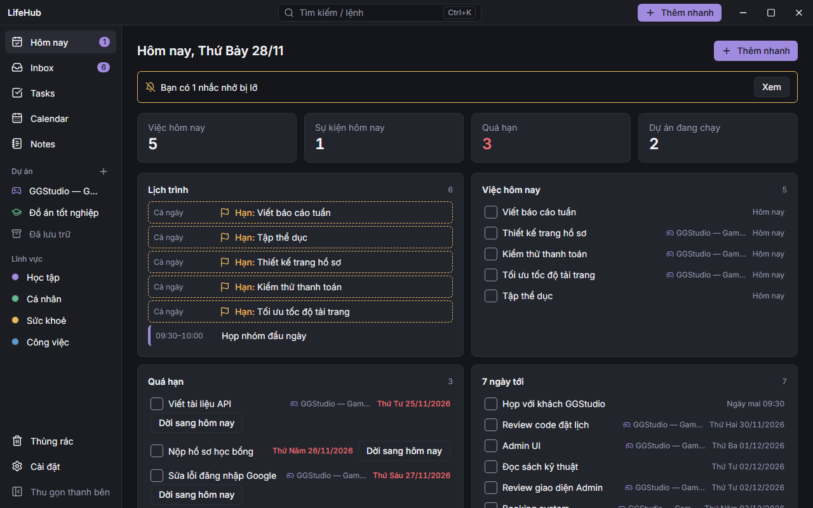
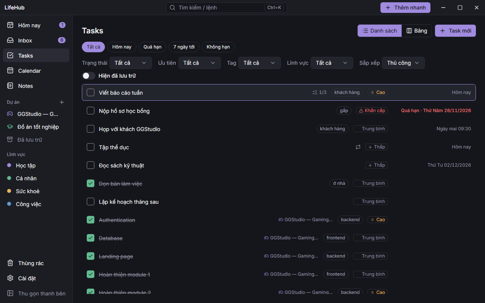
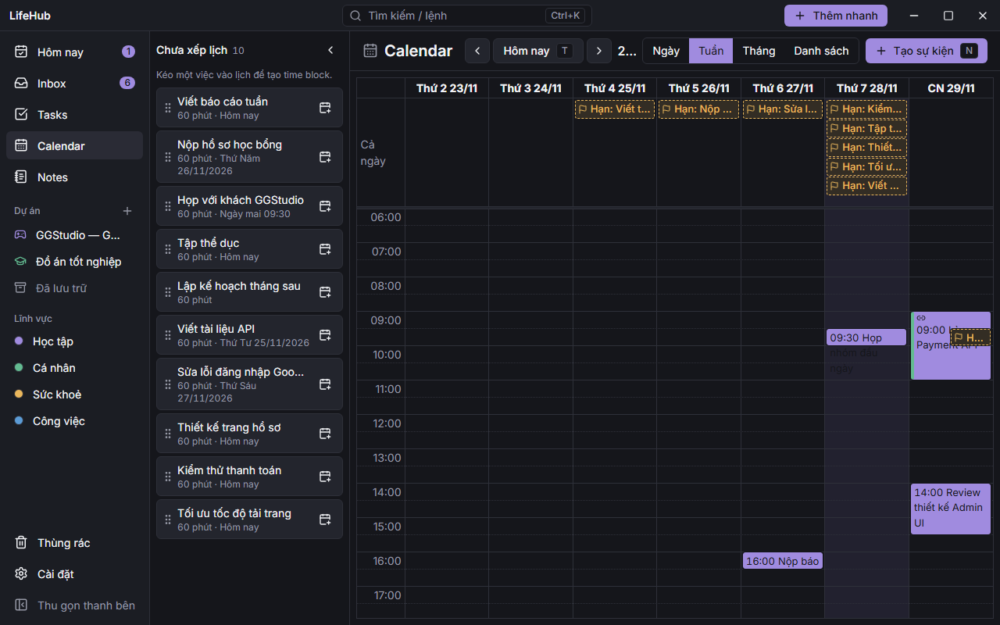
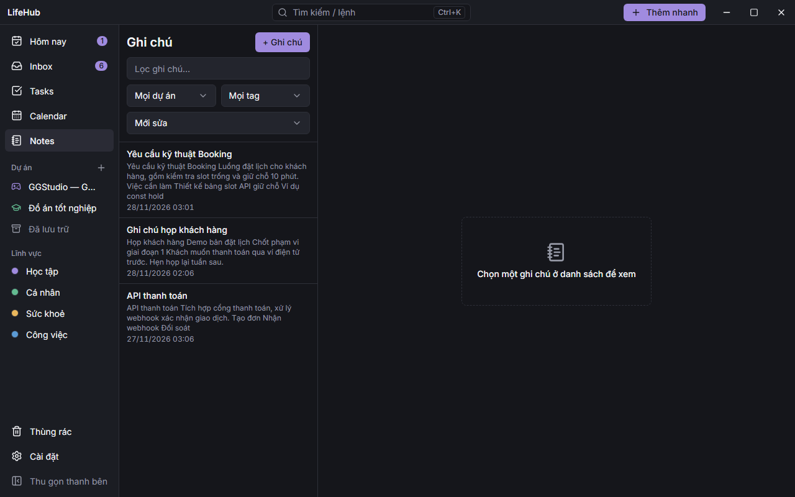
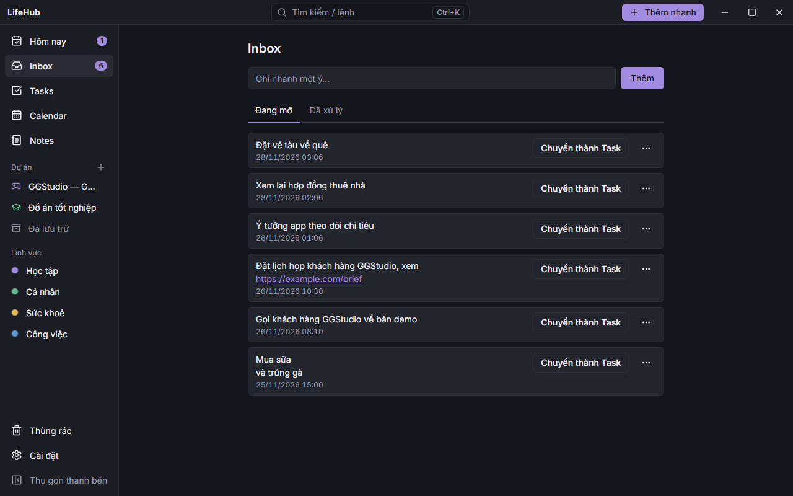
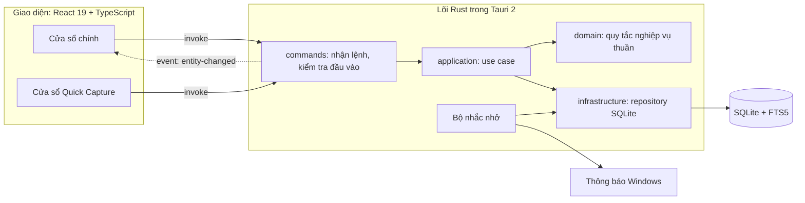
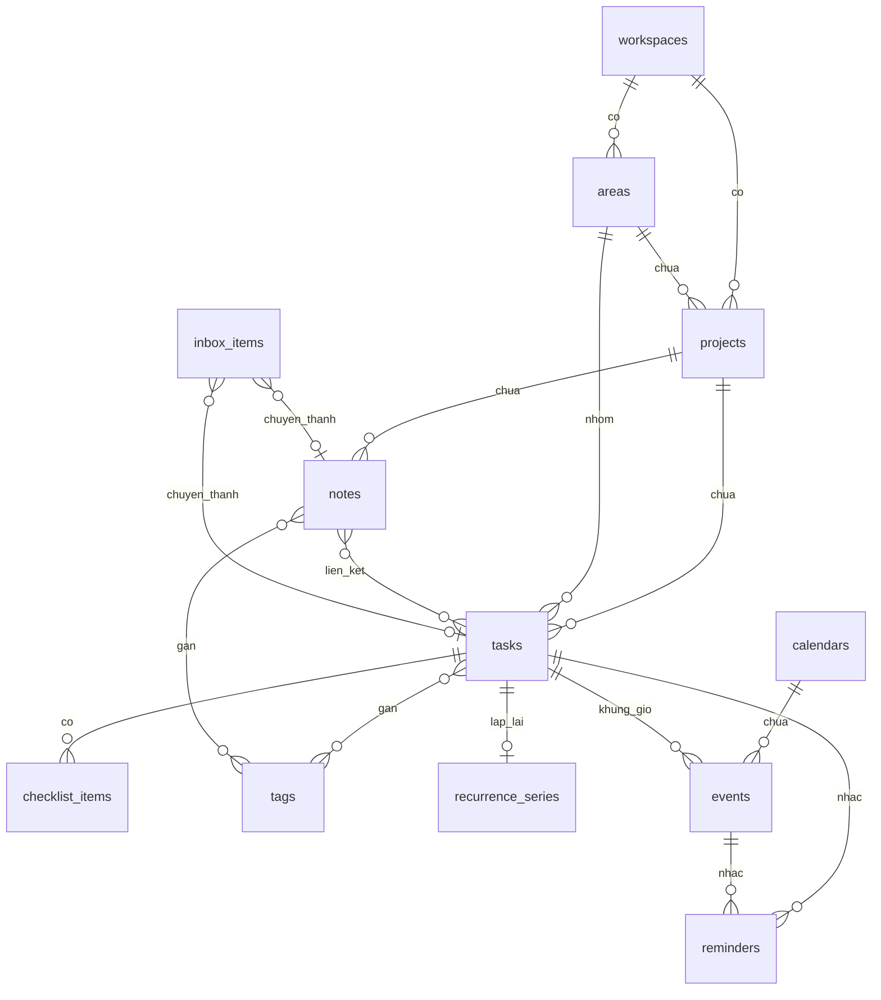

# LifeHub

> **English summary:** LifeHub is a local-first Windows desktop app (Tauri 2, Rust, React 19, SQLite) that puts your inbox, tasks, projects, calendar, notes and daily dashboard in one place. Everything is stored in a single SQLite file on your machine: no account, no telemetry. The only network call is the update check against GitHub Releases. Download the installer from the [latest release](https://github.com/TranCongAnh-01A/MySpace/releases/latest) (not code-signed yet, so Windows SmartScreen shows a warning; see [below](#windows-smartscreen-cảnh-báo-khi-cài)).

Ứng dụng desktop Windows để quản lý việc cần làm. Dữ liệu nằm trong một file trên máy của bạn, không cần tài khoản, không gửi đi đâu.

<!-- Ảnh GIF demo: người dùng tự quay rồi bỏ comment dòng dưới.

-->



## Vấn đề và giải pháp

Việc cần làm, ý tưởng chợt đến, lịch hẹn và ghi chú thường nằm rải rác ở nhiều app. Mỗi lần chuyển qua lại là một lần mất mạch.

LifeHub gom chúng lại:
- Ý tưởng chợt đến thì bấm một phím tắt toàn hệ thống, gõ một dòng, xong. Xử lý sau trong Inbox.
- Việc, dự án, lịch, ghi chú liên kết với nhau, nên từ một việc bạn mở được ghi chú và lịch của nó.
- Dữ liệu ở lại trên máy bạn. App chạy được khi không có mạng.

## Tính năng

| Module | Có gì |
|---|---|
| **Inbox + Quick Capture** | Phím tắt toàn hệ thống (mặc định `Ctrl+Shift+Space`) mở ô ghi nhanh; Inbox chuyển mục thành việc hoặc ghi chú. |
| **Tasks** | Hạn, giờ, ưu tiên, nhãn, việc con, danh sách kiểm tra, lặp lại; lọc và tìm kiếm không dấu ("nhac nho" ra "nhắc nhở"). |
| **Projects** | Bảng Kanban kéo thả (cả bằng bàn phím), tiến độ, lĩnh vực (Area), lưu trữ dự án. |
| **Calendar** | Xem tháng, tuần, ngày, danh sách; kéo việc vào lịch để tạo khung giờ; sự kiện. |
| **Notes** | Soạn thảo có định dạng, tự lưu, gắn với dự án và việc, phát hiện xung đột khi sửa. |
| **Today / Dashboard** | Việc hôm nay, quá hạn, 7 ngày tới, sự kiện, nhắc nhở bị lỡ. |

Ngoài ra: nhắc nhở bằng thông báo Windows, khay hệ thống, khởi động cùng Windows, sao lưu và khôi phục, thùng rác, xuất JSON, giao diện sáng/tối, tiếng Việt và tiếng Anh, tự cập nhật.

| Tasks | Calendar |
|---|---|
|  |  |
| **Notes** | **Inbox** |
|  |  |

> Ảnh chụp từ chế độ mock (`VITE_IPC_MOCK=1`) với dữ liệu mẫu.

## Cài đặt

1. Tải `LifeHub_x.y.z_x64-setup.exe` ở trang [Releases (bản mới nhất)](https://github.com/TranCongAnh-01A/MySpace/releases/latest).
2. Chạy file. Cài theo người dùng hiện tại, **không cần quyền quản trị**.
3. Cần Windows 10/11 có WebView2 (Windows 11 có sẵn).

Dung lượng bộ cài: khoảng 3,7 MB (đo ở bản 0.9.0; mục tiêu dưới 15 MB).

### Windows SmartScreen: cảnh báo khi cài

Khi chạy bộ cài, Windows có thể hiện "Windows protected your PC". Lý do: bộ cài **chưa được ký Authenticode** (chứng thư ký mã tốn phí hằng năm), nên SmartScreen chưa biết nhà phát hành. Quyết định này ghi ở [ADR-008](docs/adr/ADR-008-phan-phoi.md).

Để cài:
1. Bấm **More info**.
2. Bấm **Run anyway**.

Gói cập nhật tự động thì khác: nó được **ký bằng khoá riêng của updater** và LifeHub từ chối cài gói có chữ ký sai.

## Dữ liệu, sao lưu và quyền riêng tư

- **Nơi lưu:** `%LOCALAPPDATA%\com.lifehub.app` (file `lifehub.db`, thư mục `logs`, thư mục `backups`). Mở nhanh bằng **Cài đặt → Dữ liệu**.
- **Sao lưu:** app tự sao lưu mỗi ngày và trước khi cập nhật; bấm **Cài đặt → Dữ liệu** để sao lưu ngay hoặc khôi phục một bản. Có thể xuất toàn bộ dữ liệu ra JSON.
- **Quyền riêng tư:** dữ liệu chỉ nằm trên máy. Không có telemetry, không có tài khoản. Kết nối mạng duy nhất là kiểm tra cập nhật tới GitHub Releases (không gửi dữ liệu của bạn).
- **Gỡ cài đặt:** xem mục Gỡ cài đặt trong [checklist cài thử](docs/release/install-checklist.md).

## Kiến trúc

Nghiệp vụ nằm ở Rust ([ADR-003](docs/adr/ADR-003-nghiep-vu-o-rust.md)); giao diện React chỉ gọi lệnh qua IPC có kiểu (kiểu TypeScript được sinh từ Rust bằng `ts-rs`).



Mỗi module trong `src-tauri/src/modules/` (tasks, projects, notes, calendar, inbox, tags, areas, search, trash, dashboard, settings) có đủ các lớp domain, application, infrastructure, commands.

### Mô hình dữ liệu (các bảng chính)



Chi tiết: [schema](docs/plan/lifehub_schema_20261126.md) và `src-tauri/migrations/001_init.sql`. Tìm kiếm dùng FTS5 với `unicode61 remove_diacritics 2` ([ADR-004](docs/adr/ADR-004-tim-kiem-fts5.md)).

### Quyết định kiến trúc (ADR)

1. [ADR-001: Nền tảng Tauri 2](docs/adr/ADR-001-nen-tang-tauri.md)
2. [ADR-002: Local-first, không tài khoản](docs/adr/ADR-002-local-first.md)
3. [ADR-003: Nghiệp vụ nằm ở Rust](docs/adr/ADR-003-nghiep-vu-o-rust.md)
4. [ADR-004: Tìm kiếm bằng FTS5](docs/adr/ADR-004-tim-kiem-fts5.md)
5. [ADR-005: Trạng thái Task cố định](docs/adr/ADR-005-trang-thai-task-co-dinh.md)
6. [ADR-006: Fractional indexing cho kéo thả](docs/adr/ADR-006-fractional-indexing.md)
7. [ADR-007: Phạm vi lặp lại](docs/adr/ADR-007-pham-vi-lap-lai.md)
8. [ADR-008: Phân phối NSIS và Auto Update](docs/adr/ADR-008-phan-phoi.md)

Tài liệu dự án khác nằm trong [docs/](docs/INDEX.md).

## Phát triển

Yêu cầu: Windows 10/11 có WebView2, Node 22 + npm, Rust stable (MSVC) và Visual Studio Build Tools (C++).

```powershell
npm ci                # cài thư viện
npm run tauri dev     # chạy app ở chế độ dev
npm run lint          # ESLint
npm test              # Vitest
npm run build         # kiểm tra kiểu + build frontend
npm run version:check # package.json và Cargo.toml cùng một phiên bản
```

```powershell
cd src-tauri
cargo fmt --check
cargo clippy --all-targets -- -D warnings
cargo test
```

Chạy giao diện trong trình duyệt thường với dữ liệu giả (không cần Rust): đặt biến `VITE_IPC_MOCK=1` rồi `npx vite`.

### Kiểm thử đầu-cuối (E2E)

WebdriverIO + `tauri-driver` điều khiển bản debug với thư mục dữ liệu tạm, không đụng dữ liệu thật.

```powershell
npm run e2e:setup   # một lần: tải msedgedriver đúng phiên bản WebView2
npm run e2e:build   # build bản debug
npm run e2e         # chạy 5 spec
```

Cần cài `tauri-driver` một lần: `cargo install tauri-driver --locked`.

## Phát hành (cho người duy trì)

Phát hành qua GitHub Releases; app tự cập nhật từ `releases/latest`. Workflow [release.yml](.github/workflows/release.yml) chạy khi đẩy tag `v*` và chỉ tạo **bản nháp**.

1. **Tạo khoá ký updater** (một lần, trên máy của bạn, có đặt mật khẩu):
   ```powershell
   npm run tauri signer generate -- -w "$env:USERPROFILE\.tauri\lifehub.key"
   ```
   Lệnh tạo `lifehub.key` (bí mật) và `lifehub.key.pub` (công khai). Chép nội dung `.pub` vào `plugins.updater.pubkey` trong `src-tauri/tauri.conf.json`.
2. **Dán vào GitHub** → Settings → Secrets and variables → Actions:
   - `TAURI_SIGNING_PRIVATE_KEY`: nội dung file `lifehub.key`
   - `TAURI_SIGNING_PRIVATE_KEY_PASSWORD`: mật khẩu khoá
3. **Sao lưu khoá bí mật** ở chỗ an toàn. ⚠️ **Mất khoá thì các bản đã cài không cập nhật được nữa.** Không bao giờ commit file `.key` (đã có trong `.gitignore`).
4. **Chuẩn bị bản phát hành:** đổi `version` trong `package.json` và `src-tauri/Cargo.toml` (`npm run version:check` phải xanh), viết `docs/release/vX.Y.Z.md` (workflow dùng file này làm nội dung release và báo lỗi nếu thiếu).
5. **Đẩy tag:** `git tag vX.Y.Z` rồi `git push origin vX.Y.Z`. Tag phải đúng `v<version>`.
6. **Xem bản nháp** trên trang Releases (đủ `LifeHub_X.Y.Z_x64-setup.exe`, file `.sig`, `latest.json`), rồi bấm **Publish**. Chỉ lúc đó người dùng mới nhận được bản mới.

Cài thử trên máy sạch và thử cập nhật: [checklist](docs/release/install-checklist.md). Ghi chú các bản: [docs/release/](docs/release/).

## Giấy phép

Chưa chọn giấy phép. Khi chưa có file `LICENSE`, mã nguồn được bảo lưu mọi quyền.
