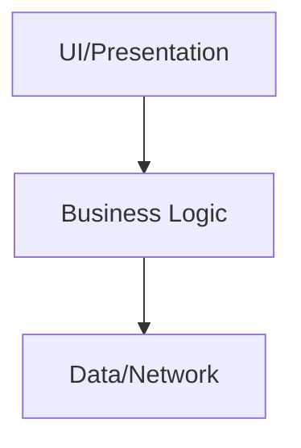

# ONBOARDING — Tài liệu Hướng dẫn Thành viên Mới

> ⚠️ File nằm trong danh sách ngoại lệ (G.2) — **luôn ghi đè/cập nhật trực tiếp**, không đính kèm ngày tháng.
> Nội dung được tạo/cập nhật tự động khi dùng trigger `#onboard` (xem E.13).

**Cập nhật lần cuối:** 2026-11-26 00:32

---

## 1. Tổng quan Kiến trúc Dự án
- Mô hình kiến trúc: ...
- Sơ đồ tổng quan (khuyến khích Mermaid):


## 2. Danh sách Tech Stack Đang Sử Dụng
| Thành phần | Công nghệ | Phiên bản |
|---|---|---|
| ... | ... | ... |

## 3. Quy ước Viết Code của Team
- **Naming convention:** ...
- **Cấu trúc thư mục:**
```
src/
├── ...
```
- **Quy tắc code khác:** xem chi tiết tại [Global/Local Rule](./LOCAL_RULE.md)

## 4. Luồng Làm việc với Git
- Quy tắc commit: `<Loại_commit>: <Mô tả bằng Tiếng Việt>`
- Quy trình branch: (VD: `main` → `develop` → `feature/*`)
- Quy trình review/merge: ...

## 5. Danh sách File/Module Trọng yếu Cần Đọc Trước
| Thứ tự | File/Module | Lý do cần đọc |
|---|---|---|
| 1 | [PROJECT_CONTEXT.md](./PROJECT_CONTEXT.md) | Nắm bối cảnh & ràng buộc dự án |
| 2 | [LOCAL_RULE.md](./LOCAL_RULE.md) | Quy tắc riêng của dự án |
| 3 | ... | ... |

## 6. Câu hỏi Thường gặp (FAQ) — tuỳ chọn
- **Q:** ...
  **A:** ...
