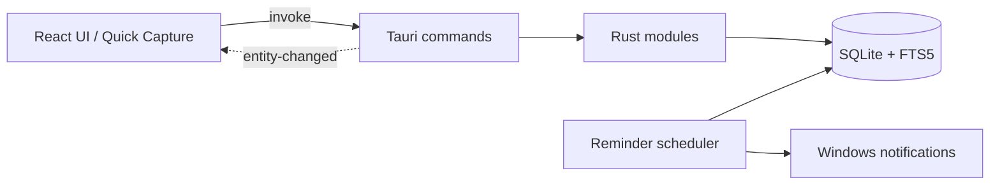

# PROJECT CONTEXT — Bối cảnh Dự án

> ⚠️ File nằm trong danh sách ngoại lệ (G.2) — **luôn ghi đè/cập nhật trực tiếp**, không đính kèm ngày tháng.

**Cập nhật lần cuối:** 2026-11-26 23:20

---

## 1. Tổng quan Dự án
- **Tên dự án:** LifeHub (repo/thư mục: MySpace) — chờ người dùng chốt tên và identifier `com.lifehub.app`
- **Thư mục:** `D:\04.Project_me\MySpace`
- **Mục tiêu chính:** ứng dụng desktop Windows (`.exe`) local-first gom Inbox/Quick Capture, Tasks, Projects, Calendar, Notes, Dashboard; dự án chủ lực cho CV. Spec: [./spec/lifehub_spec_20261126.md](./spec/lifehub_spec_20261126.md)
- **Đối tượng người dùng:** một người dùng trên Windows 10/11, không tài khoản
- **Trạng thái hiện tại:** **v0.4 đã merge vào `main`** (tag `v0.4.0`, chưa push). v0.1–v0.3: khung, Settings, Areas, Backup, design system, Inbox, Tasks (List/Board/lặp/checklist/tag), Trash, search, Command Palette, Projects, Today, dữ liệu mẫu. v0.4: Calendar (FullCalendar ngày/tuần/tháng/danh sách, kéo thả Event và deadline, time blocking), Reminders + scheduler + thông báo Windows (bấm mở đúng bản ghi), nhắc nhở bị lỡ, khay "Việc hôm nay"/"Tạm dừng thông báo", Today có Lịch trình. Trên bản gộp: lint, tsc, Vitest 104/104, build, fmt, clippy --all-targets, cargo test 216/216 xanh. **Người dùng đã thử trên bản `.exe` đã cài (2026-11-26): OK** — thông báo Windows khi app ở khay, bấm thông báo mở đúng Task, nhắc nhở bị lỡ, kéo thả Calendar, menu khay. Lưu ý: số phiên bản app vẫn là `0.1.0` (chưa ai tăng; để phiên D lo khi làm updater). Bước tiếp: B5 + C5 (v0.5: Notes). ADR ở [./adr/](./adr/).

## 2. Tech Stack
| Tầng | Công nghệ | Phiên bản | Ghi chú |
|---|---|---|---|
| Frontend | React + TypeScript + Vite, Tailwind v4, shadcn/ui, TanStack Query, Zustand, React Router, Tiptap, FullCalendar (MIT), dnd-kit | React 19 | WebView2 |
| Backend | Rust core trong Tauri 2 (rusqlite, rusqlite_migration, ts-rs, tokio, tracing) | Rust 1.99 | nghiệp vụ chỉ ở Rust (ADR-003) |
| Database | SQLite (WAL, FTS5 `unicode61 remove_diacritics 2`) | bundled | [schema](./plan/lifehub_schema_20261126.md) |
| DevOps/Hạ tầng | GitHub Actions `windows-latest`, tauri-action, NSIS, updater qua GitHub Releases | — | máy có Node 22, npm 11, MSVC Build Tools 2019 |

## 3. Kiến trúc Tổng quan
- **Mô hình kiến trúc:** Tauri 2; Rust core là modular monolith theo chiều dọc (domain / application / infrastructure / commands mỗi module); frontend chỉ gọi command qua IPC có kiểu.
- **Sơ đồ luồng chính** *(khuyến khích dùng Mermaid)*:


## 4. Ràng buộc Kỹ thuật & Nghiệp vụ
- Ràng buộc kỹ thuật: offline hoàn toàn; không tải script/font từ mạng; capability Tauri tối thiểu; một kết nối ghi SQLite.
- **Git/GitHub:** có git, remote `origin` = https://github.com/TranCongAnh-01A/MySpace.git, nhánh mặc định `main` (kiểm tra 2026-11-26). Máy chưa cài `gh`. `.gitignore` đã tạo (A1).
- Ràng buộc nghiệp vụ: xem quy tắc đã chốt ở [analysis mục 3](./plan/lifehub_analysis_20261126.md) và [schema mục 3](./plan/lifehub_schema_20261126.md).
- Các quy định đặc thù (pháp lý, bảo mật ngành, v.v.): ...

## 5. Quy ước Đặt tên & Cấu trúc Thư mục
```
MySpace/
├── src/          # React (phiên C)
├── src-tauri/    # Rust core (phiên B)
├── tests/e2e/    # phiên D
├── .github/      # CI
└── docs/
```

## 6. Danh sách Module/Tính năng Chính
| Module | Mô tả | Trạng thái |
|---|---|---|
| Khung + Quick Capture → Inbox | Phiên A | Xong (A1 ✅, A2 ✅) |
| Nền tảng v0.1: Settings, Areas, Backup, design system | B1 + C1 | Xong, đã merge (v0.1.0) |
| Inbox, Tasks, Search | v0.2 (B2 + C2) | Xong, đã merge (v0.2.0) |
| Projects, Kanban, Dashboard | v0.3 (B3 + C3) | Xong, đã merge (v0.3.0) |
| Calendar, Reminders | v0.4 (B4 + C4) | Xong, đã merge (v0.4.0), đã thử trên bản cài |
| Notes | v0.5 (B5 + C5) | Chưa bắt đầu |
| E2E, Auto Update, v1.0 | Phiên D | Chưa bắt đầu |

## 7. Liên kết Liên quan
- Xem thêm tại [Bản đồ tài liệu](./INDEX.md)
- Rule cục bộ: [./LOCAL_RULE.md](./LOCAL_RULE.md)
