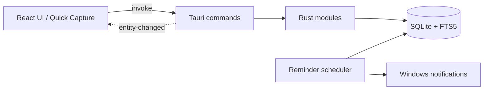

# PROJECT CONTEXT — Bối cảnh Dự án

> ⚠️ File nằm trong danh sách ngoại lệ (G.2) — **luôn ghi đè/cập nhật trực tiếp**, không đính kèm ngày tháng.

**Cập nhật lần cuối:** 2026-11-27 01:30

---

## 1. Tổng quan Dự án
- **Tên dự án:** LifeHub (repo/thư mục: MySpace) — chờ người dùng chốt tên và identifier `com.lifehub.app`
- **Thư mục:** `D:\04.Project_me\MySpace`
- **Mục tiêu chính:** ứng dụng desktop Windows (`.exe`) local-first gom Inbox/Quick Capture, Tasks, Projects, Calendar, Notes, Dashboard; dự án chủ lực cho CV. Spec: [./spec/lifehub_spec_20261126.md](./spec/lifehub_spec_20261126.md)
- **Đối tượng người dùng:** một người dùng trên Windows 10/11, không tài khoản
- **Trạng thái hiện tại:** **v0.5 đã merge vào `main`** (tag `v0.5.0`, đã push) — **đủ 6 module MVP**: Inbox + Quick Capture, Tasks, Projects, Calendar, Notes, Today/Dashboard; kèm Settings, Areas, Backup/Restore, Trash, search không dấu, Command Palette, nhắc nhở + thông báo Windows (đã thử trên bản cài ở v0.4). v0.5: Notes (Tiptap, slash command, code block, auto save 1s, CONFLICT, allowlist node/mark ở cả UI và core, thoát an toàn `app-will-quit`). Trên bản gộp: lint, tsc, Vitest 136/136, build, fmt, clippy --all-targets, cargo test 255/255 xanh. **Người dùng đã thử Notes trên bản cài (2026-11-27): OK** — soạn thảo, slash command, auto save, `Ctrl+Q` ngay sau khi gõ không mất chữ, dán HTML, liên kết Project/Task/Inbox/Today, tìm không dấu. **D1 đã merge vào `main` và push (2026-11-28, `78cc73c`, không tag):** E2E WebdriverIO + tauri-driver (5 spec xanh trên máy, cách ly dữ liệu qua `LIFEHUB_DATA_DIR` chỉ ở bản debug), test nâng cấp DB từ fixture v0.5.0 và backup→restore trên file, phiên bản 0.5.0 một nguồn (`version:check`), chunk chính 891 → 340 kB; cargo test 260. **Việc còn mở:** job `e2e` trên CI đỏ (`DevToolsActivePort`, WebView2 157 trên runner, máy 158) nên tạm `continue-on-error` — xem [log D1](./log/log_20261127_1200.md). **D2 đã merge vào `main` (2026-11-28):** updater Tauri (lưu Note → sao lưu → cài; bản debug/E2E không gọi mạng), workflow `release.yml` (tag `v*` → bản nháp + `latest.json`), README đầy đủ, release notes, checklist cài thử; repo đã public, quét bí mật sạch; khoá ký trong Secrets (người dùng giữ). Vitest 147, cargo test 260. **Đã phát hành `v0.9.0` và `v0.9.1` trên GitHub Releases; người dùng xác nhận (2026-11-28) bản 0.9.0 đã cài tự cập nhật lên 0.9.1 OK — D2 xong.** Chưa có LICENSE. **D3a đã merge vào `main` (2026-11-28, `2519add`):** perf core đều dưới 100 ms trên 5.000 Task / 10.000 bản ghi ([perf-v1](./release/perf-v1.md)); log `startup_ms`, `quick_capture_show_ms` (chờ đo trên bản cài); bảng nghiệm thu ✅ 7 · ⚠️ 4 · ☐ 2 ([acceptance-v1](./release/acceptance-v1.md)); E2E trên CI vẫn đỏ sau 2 giả thuyết (app chạy, WebView2 runner 157 không ghi `DevToolsActivePort`) → giới hạn đã biết, chạy `npm run e2e` trên máy trước mỗi lần phát hành ([log D3a](./log/log_20261128_d3a.md)). Song song: người dùng dùng thật ~2 tuần (từ 2026-11-28), ghi điểm khó chịu vào Inbox → D3b sửa theo lô, tag `v1.0.0`. ADR ở [./adr/](./adr/).

## 2. Tech Stack
| Tầng | Công nghệ | Phiên bản | Ghi chú |
|---|---|---|---|
| Frontend | React + TypeScript + Vite, Tailwind v4, shadcn/ui, TanStack Query, Zustand, React Router, Tiptap, FullCalendar (MIT), dnd-kit | React 19 | WebView2 |
| Backend | Rust core trong Tauri 2 (rusqlite, rusqlite_migration, ts-rs, tokio, tracing) | Rust 1.99 | nghiệp vụ chỉ ở Rust (ADR-003) |
| Database | SQLite (WAL, FTS5 `unicode61 remove_diacritics 2`) | bundled | [schema](./plan/lifehub_schema_20261126.md) |
| DevOps/Hạ tầng | GitHub Actions `windows-latest`, tauri-action, NSIS, updater qua GitHub Releases | — | máy có Node 22, npm 11, MSVC Build Tools 2019 |

## 3. Kiến trúc Tổng quan
- **Mô hình kiến trúc:** Tauri 2; Rust core là modular monolith theo chiều dọc (domain / application / infrastructure / commands mỗi module); frontend chỉ gọi command qua IPC có kiểu.
- **Sơ đồ luồng chính** *(khuyến khích dùng Mermaid)*:


## 4. Ràng buộc Kỹ thuật & Nghiệp vụ
- Ràng buộc kỹ thuật: offline hoàn toàn; không tải script/font từ mạng; capability Tauri tối thiểu; một kết nối ghi SQLite.
- **Git/GitHub:** có git, remote `origin` = https://github.com/TranCongAnh-01A/MySpace.git, nhánh mặc định `main` (kiểm tra 2026-11-26). Máy chưa cài `gh`. `.gitignore` đã tạo (A1).
- Ràng buộc nghiệp vụ: xem quy tắc đã chốt ở [analysis mục 3](./plan/lifehub_analysis_20261126.md) và [schema mục 3](./plan/lifehub_schema_20261126.md).
- Các quy định đặc thù (pháp lý, bảo mật ngành, v.v.): ...

## 5. Quy ước Đặt tên & Cấu trúc Thư mục
```
MySpace/
├── src/          # React (phiên C)
├── src-tauri/    # Rust core (phiên B)
├── tests/e2e/    # phiên D
├── .github/      # CI
└── docs/
```

## 6. Danh sách Module/Tính năng Chính
| Module | Mô tả | Trạng thái |
|---|---|---|
| Khung + Quick Capture → Inbox | Phiên A | Xong (A1 ✅, A2 ✅) |
| Nền tảng v0.1: Settings, Areas, Backup, design system | B1 + C1 | Xong, đã merge (v0.1.0) |
| Inbox, Tasks, Search | v0.2 (B2 + C2) | Xong, đã merge (v0.2.0) |
| Projects, Kanban, Dashboard | v0.3 (B3 + C3) | Xong, đã merge (v0.3.0) |
| Calendar, Reminders | v0.4 (B4 + C4) | Xong, đã merge (v0.4.0), đã thử trên bản cài |
| Notes | v0.5 (B5 + C5) | Xong, đã merge (v0.5.0), đã thử trên bản cài |
| E2E, Auto Update, v1.0 | Phiên D | D1, D2 xong (v0.9.1 đã phát hành); D3 chưa bắt đầu; E2E CI còn mở |

## 7. Liên kết Liên quan
- Xem thêm tại [Bản đồ tài liệu](./INDEX.md)
- Rule cục bộ: [./LOCAL_RULE.md](./LOCAL_RULE.md)
