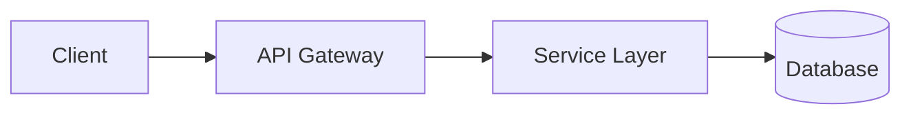

# PROJECT CONTEXT — Bối cảnh Dự án

> ⚠️ File nằm trong danh sách ngoại lệ (G.2) — **luôn ghi đè/cập nhật trực tiếp**, không đính kèm ngày tháng.

**Cập nhật lần cuối:** 2026-11-26 00:32

---

## 1. Tổng quan Dự án
- **Tên dự án:** MySpace
- **Thư mục:** `D:\04.Project_me\MySpace`
- **Mục tiêu chính:** ...
- **Đối tượng người dùng:** ...
- **Trạng thái hiện tại:** Khởi tạo — mới có `docs/`, chưa có code, chưa có kế hoạch

## 2. Tech Stack
| Tầng | Công nghệ | Phiên bản | Ghi chú |
|---|---|---|---|
| Frontend | ... | ... | ... |
| Backend | ... | ... | ... |
| Database | ... | ... | ... |
| DevOps/Hạ tầng | ... | ... | ... |

## 3. Kiến trúc Tổng quan
- **Mô hình kiến trúc:** (VD: Clean Architecture, MVVM, BLoC, Microservices...)
- **Sơ đồ luồng chính** *(khuyến khích dùng Mermaid)*:


## 4. Ràng buộc Kỹ thuật & Nghiệp vụ
- Ràng buộc kỹ thuật: ...
- **Git/GitHub:** chưa có git, chưa có remote GitHub (kiểm tra 2026-11-26). Máy chưa cài `gh`. Chưa có git thì các session phải chạy tuần tự.
- Ràng buộc nghiệp vụ: ...
- Các quy định đặc thù (pháp lý, bảo mật ngành, v.v.): ...

## 5. Quy ước Đặt tên & Cấu trúc Thư mục
```
project-root/
├── src/ (hoặc lib/)
├── docs/
├── tests/
└── ...
```

## 6. Danh sách Module/Tính năng Chính
| Module | Mô tả | Trạng thái |
|---|---|---|
| ... | ... | ... |

## 7. Liên kết Liên quan
- Xem thêm tại [Bản đồ tài liệu](./INDEX.md)
- Rule cục bộ: [./LOCAL_RULE.md](./LOCAL_RULE.md)
