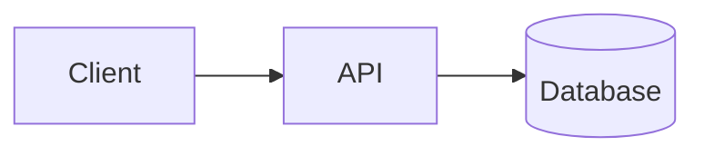

<!-- 
🚨 TEMPLATE INSTRUCTION: 
- [HUMAN] Please copy this template, fill in the blanks, and DELETE this comment block before saving.
- [AGENT/MCP] You MUST remove this entire comment block and all placeholder tags (e.g., [Tên_lệnh]) when generating the final file. Do not output this instruction block to the user.
-->

# AUDIT REPORT — [Tên Dự Án]

> ⚠️ File này KHÔNG nằm trong danh sách ngoại lệ (G.2) — khi tạo thật, đặt tên theo dạng:
> `docs/audit/[ten_du_an]_audit_YYYYMMDD.md` (VD: `sohuutritue_test_audit_20260712.md`).
> Nếu trùng ngày, thêm hậu tố `_HHMM` hoặc `_v2`.
> Sau khi tạo, nhớ cập nhật liên kết vào [docs/INDEX.md](./INDEX.md).

**Ngày kiểm toán:** YYYY-MM-DD HH:MM
**Phạm vi kiểm toán:** (Toàn bộ dự án / Smart Contract / Frontend / Backend / ...)


---

## 1. Tổng Quan Kiến Trúc
### 1.1 Cấu trúc thư mục
```
project-root/
├── ...
```
### 1.2 Bảng Tech Stack
| Tầng | Công nghệ | Phiên bản |
|---|---|---|
| ... | ... | ... |

### 1.3 Luồng Hoạt động Chính


## 2. Phân Tích Từng Tầng
### 2.1 [Tên Tầng, VD: Backend]
| Hàm/Component | Trạng thái | Ghi chú |
|---|---|---|
| ... | ✅/⚠️/❌ | ... |

> [!WARNING]
> Ghi chú cảnh báo nếu có vấn đề thiết kế.

## 3. Ma Trận Lỗi Tiềm Ẩn (Bug Matrix)
| Mức độ | Mô tả lỗi | File liên quan |
|---|---|---|
| 🔴 CRITICAL | ... | ... |
| 🟠 HIGH | ... | ... |
| 🟡 MEDIUM | ... | ... |
| 🔵 LOW | ... | ... |

## 4. Chi Tiết Lỗi & Khắc Phục
### 4.1 [Tên lỗi]
- **File gây lỗi:** `path/to/file`
- **Tác động:** ...
- **Code mẫu khắc phục:**
```
// Vị trí: path/to/file
// Mô tả: đoạn code sửa lỗi ...
```

## 5. Đánh Giá Bảo Mật & Lộ Trình
### 5.1 OWASP Checklist
- [ ] ...
- [ ] ...

### 5.2 Roadmap Khắc phục
| Phase | Công việc | Ưu tiên |
|---|---|---|
| Hotfix ngay | ... | Cao |
| Refactor | ... | Trung bình |
| Production Ready | ... | Thấp |
