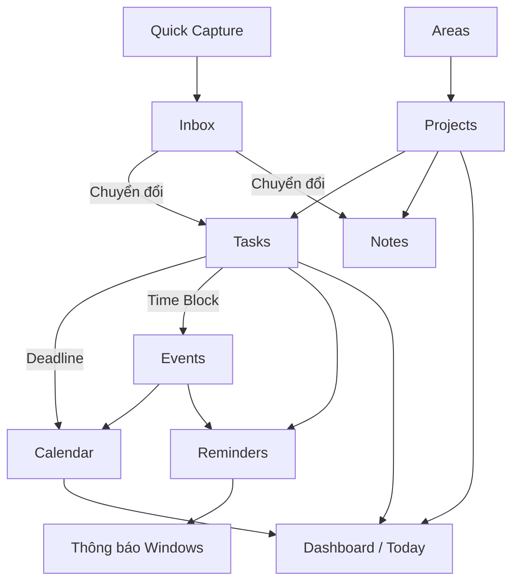
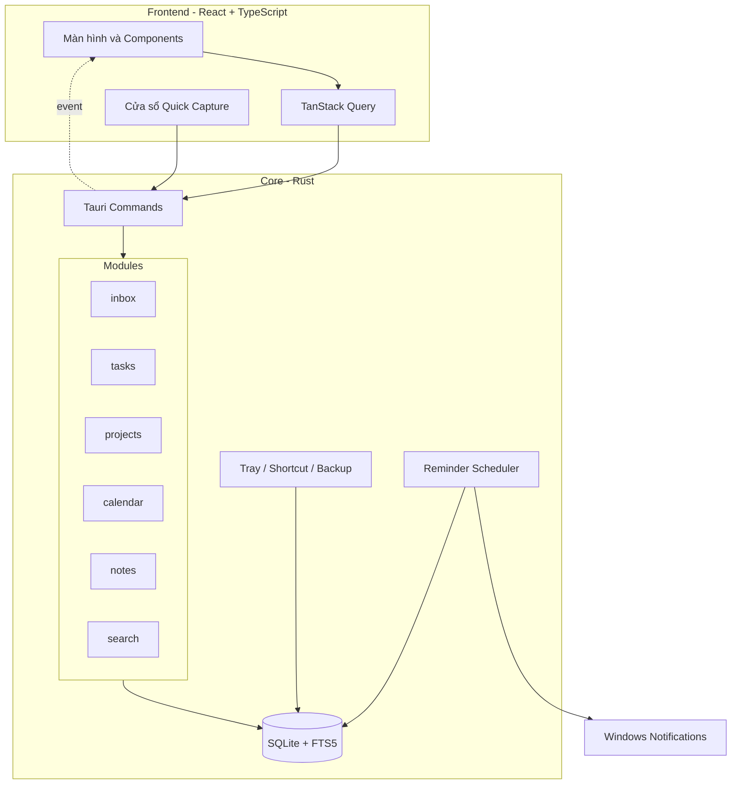
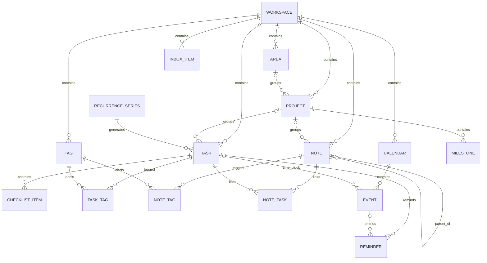

# LifeHub — Kế hoạch phát triển không gian làm việc cá nhân (Desktop)

> **Personal Productivity Workspace cho Windows**  
> Slogan đề xuất: Your Life. Your Work. One Workspace.  
> Loại dự án: Personal Project, Desktop Application (Windows `.exe`), Local-first.  
> Trạng thái tài liệu: Kế hoạch đề xuất, chưa phải mô tả tính năng đã triển khai.

## Mục lục

1. [Tổng quan và định hướng](#1-tổng-quan-và-định-hướng)
2. [Phạm vi sản phẩm](#2-phạm-vi-sản-phẩm)
3. [Yêu cầu chức năng](#3-yêu-cầu-chức-năng)
4. [Thiết kế UI/UX](#4-thiết-kế-uiux)
5. [Nghiệp vụ liên kết giữa các module](#5-nghiệp-vụ-liên-kết-giữa-các-module)
6. [Công nghệ sử dụng](#6-công-nghệ-sử-dụng)
7. [Kiến trúc hệ thống](#7-kiến-trúc-hệ-thống)
8. [Thiết kế cơ sở dữ liệu](#8-thiết-kế-cơ-sở-dữ-liệu)
9. [Tính năng hệ thống và yêu cầu phi chức năng](#9-tính-năng-hệ-thống-và-yêu-cầu-phi-chức-năng)
10. [Lộ trình phát triển](#10-lộ-trình-phát-triển)
11. [Phân chia phiên bản](#11-phân-chia-phiên-bản)
12. [Kiểm thử, đóng gói và tiêu chí hoàn thành](#12-kiểm-thử-đóng-gói-và-tiêu-chí-hoàn-thành)
13. [Rủi ro và phương án dự phòng](#13-rủi-ro-và-phương-án-dự-phòng)
14. [Các quyết định kiến trúc (ADR)](#14-các-quyết-định-kiến-trúc-adr)
15. [Đưa dự án vào CV](#15-đưa-dự-án-vào-cv)
16. [Tên sản phẩm và hành động bắt đầu](#16-tên-sản-phẩm-và-hành-động-bắt-đầu)

---

## 1. Tổng quan và định hướng

### 1.1. Giới thiệu

LifeHub là ứng dụng desktop cho Windows, cài đặt bằng file `.exe`, dùng để quản lý công việc, dự án, lịch biểu và ghi chú trong một không gian thống nhất. Dữ liệu lưu cục bộ trên máy người dùng (local-first), dùng được hoàn toàn khi không có mạng và không cần tài khoản.

Mục tiêu là tạo một sản phẩm dùng được hằng ngày, từng bước thay thế những chức năng cần thiết của nhiều ứng dụng hiện có, và làm dự án chủ lực trong Portfolio/CV ứng tuyển Software Engineer, Desktop Developer hoặc Full-stack Developer.

### 1.2. Vấn đề cần giải quyết

- Dữ liệu công việc, ghi chú, lịch biểu và mục tiêu nằm rải rác ở nhiều ứng dụng.
- Người dùng phải chuyển qua lại giữa các công cụ để hoàn thành một quy trình.
- Công việc, deadline, ghi chú và thời gian thực hiện không được liên kết nhất quán.
- Nhiều ứng dụng năng suất phụ thuộc vào cloud, chậm khi mạng yếu và người dùng không kiểm soát được dữ liệu của mình.
- Muốn thu thập ý tưởng tức thì từ bất kỳ đâu trên máy tính mà không phải mở trình duyệt.

### 1.3. Mục tiêu

- Tập trung những thông tin cần thiết trong một ứng dụng desktop nhẹ, khởi động nhanh.
- Tạo quy trình liên tục: thu thập → lập kế hoạch → thực hiện → tổng kết.
- Chạy offline hoàn toàn; dữ liệu nằm trong một file cơ sở dữ liệu người dùng sở hữu, sao lưu và khôi phục được.
- Tận dụng lợi thế desktop: chạy nền ở khay hệ thống, phím tắt toàn cục, thông báo Windows.
- Thể hiện năng lực phân tích nghiệp vụ, thiết kế hệ thống, lập trình, kiểm thử, đóng gói và phát hành phần mềm.

### 1.4. Các ứng dụng tham khảo

| Ứng dụng | Chức năng tham khảo |
|---|---|
| Notion | Workspace, tài liệu, block editor |
| Todoist | Quản lý công việc, Inbox, ưu tiên |
| Google Calendar | Lịch biểu, sự kiện, nhắc nhở |
| Trello | Kanban, quản lý dự án |
| Obsidian | Local-first, Markdown, backlinks |
| TickTick | Công việc, Pomodoro, quản lý thời gian |
| Linear | Điều hướng bằng bàn phím, giao diện tối giản |

LifeHub không sao chép toàn bộ các sản phẩm trên. Điểm khác biệt là liên kết dữ liệu giữa các module, chạy local-first như Obsidian, và tối ưu cho quy trình làm việc cá nhân trên desktop.

### 1.5. Đối tượng sử dụng

- Người dùng cá nhân trên Windows 10/11: sinh viên, lập trình viên, người làm việc tri thức.
- Một người dùng trên một máy. Đồng bộ nhiều thiết bị và cộng tác là hướng mở rộng sau v1.0, không thuộc MVP.

## 2. Phạm vi sản phẩm

### 2.1. Danh sách module

| STT | Module | Vai trò | Ưu tiên |
|---|---|---|---|
| 1 | Inbox + Quick Capture | Thu thập nhanh ý tưởng và thông tin | MVP |
| 2 | Tasks | Quản lý công việc | MVP |
| 3 | Projects | Quản lý dự án, Kanban | MVP |
| 4 | Calendar | Lịch biểu, deadline, time block | MVP |
| 5 | Notes | Ghi chú và tài liệu | MVP |
| 6 | Dashboard / Today | Tổng quan hằng ngày | MVP |
| 7 | Focus | Pomodoro và theo dõi thời gian | Sau v1.0 |
| 8 | Habits | Theo dõi thói quen | Sau v1.0 |
| 9 | Goals | Quản lý mục tiêu | Sau v1.0 |
| 10 | Journal | Nhật ký cá nhân | Sau v1.0 |
| 11 | Analytics | Thống kê và báo cáo | Sau v1.0 |
| 12 | Bookmarks | Quản lý liên kết | Sau v1.0 |
| 13 | Files | Tệp đính kèm | Sau v1.0 |
| 14 | Knowledge Base | Collections, liên kết hai chiều, graph | Sau v1.0 |
| 15 | Sync Server | Đồng bộ nhiều máy qua máy chủ tự host | Nâng cao |
| 16 | AI Assistant | Trợ lý AI cá nhân | Nâng cao |

Thành phần nền tảng dùng chung trong MVP: Settings, Search, Reminders/Notifications, Backup/Restore, System Tray, Global Shortcut. Today là một chế độ hiển thị của Dashboard, không phải module dữ liệu riêng.

### 2.2. Ba nhóm sản phẩm

| Work | Knowledge | Life |
|---|---|---|
| Inbox, Tasks, Projects, Calendar, Focus | Notes, Knowledge Base, Bookmarks, Files | Goals, Habits, Journal |

Dashboard, Analytics, Search và Settings hỗ trợ xuyên suốt cả ba nhóm.

### 2.3. Phạm vi MVP (v1.0)

MVP gồm sáu module: Inbox + Quick Capture, Tasks, Projects, Calendar, Notes, Dashboard/Today. Kèm theo là các thành phần nền tảng: tìm kiếm toàn văn, nhắc nhở bằng thông báo Windows, sao lưu/khôi phục, khay hệ thống, trình cài đặt `.exe` và cập nhật tự động.

**Không thuộc MVP:** tài khoản người dùng, đồng bộ, nhiều workspace, cộng tác, AI, Mobile, sự kiện lặp có ngoại lệ, Subtask nhiều cấp, trạng thái Task tùy chỉnh, Version History của Note, Gantt/Timeline.

**Mức ưu tiên trong MVP:** mỗi yêu cầu ở mục 3 được gắn nhãn **[Must]** (bắt buộc cho v1.0) hoặc **[Nice]** (làm nếu còn thời gian, có thể dời sang v1.x mà không ảnh hưởng tiêu chí nghiệm thu).

## 3. Yêu cầu chức năng

### 3.1. Dashboard / Today

**Mục đích:** Cái nhìn tổng quan về ngày làm việc ngay khi mở ứng dụng.

- [ ] [Must] Công việc hôm nay, quá hạn và sắp đến deadline (7 ngày tới).
- [ ] [Must] Lịch trình trong ngày: sự kiện và time block.
- [ ] [Must] Tiến độ các dự án đang hoạt động.
- [ ] [Must] Thêm nhanh Task, Note, Event hoặc Inbox item.
- [ ] [Must] Điều hướng từ widget đến bản ghi gốc.
- [ ] [Nice] Ghi chú gần đây.
- [ ] Sau v1.0: tùy chỉnh widget, thống kê Focus, thói quen, mục tiêu.

### 3.2. Inbox + Quick Capture

**Mục đích:** Ghi lại ý tưởng, nhiệm vụ hoặc tài nguyên phát sinh mà chưa cần phân loại.

- [ ] [Must] Quick Capture: phím tắt toàn cục (mặc định `Ctrl+Shift+Space`, cho phép đổi) mở cửa sổ nhập nhỏ ngay cả khi LifeHub đang ẩn ở khay hệ thống; Enter để lưu, Esc để đóng.
- [ ] [Must] Tạo, sửa, xóa, tìm kiếm nội dung chưa xử lý.
- [ ] [Must] Chuyển Inbox item thành Task hoặc Note trong một transaction; đánh dấu đã xử lý và lưu tham chiếu đến bản ghi được tạo, không cho chuyển đổi lần hai.
- [ ] [Must] Gán Project, Area, Tags và ngày thực hiện khi xử lý.
- [ ] [Nice] Xử lý nhiều mục cùng lúc.
- [ ] [Nice] Nhận diện URL trong nội dung và giữ dạng liên kết.

### 3.3. Tasks — Quản lý công việc

| Nhóm | Yêu cầu MVP |
|---|---|
| Công việc | Tạo, xem, sửa, lưu trữ, xóa mềm, khôi phục từ Trash |
| Checklist | Danh sách bước nhỏ trong Task, đánh dấu hoàn thành |
| Ưu tiên | Urgent, High, Medium, Low |
| Trạng thái | Todo, In Progress, Review, Done (cố định trong MVP) |
| Thời gian | Ngày bắt đầu, deadline theo ngày hoặc theo ngày giờ, thời lượng dự kiến |
| Lặp lại | Hằng ngày, tuần, tháng; hoàn thành lần này thì sinh lần tiếp theo |
| Nhắc nhở | Nhắc tại thời điểm hoặc trước deadline |
| Phân loại | Project, Area, Tags |
| Liên kết | Gắn Note với Task |
| Lọc, sắp xếp | Theo trạng thái, ưu tiên, ngày, Project, Tag |

**Chế độ hiển thị MVP:** List và Kanban; deadline hiển thị trên Calendar. Table, Timeline, Gantt để sau v1.0.

**Sau v1.0:** Subtask nhiều cấp, phụ thuộc Task (tiền nhiệm/kế nhiệm, phát hiện vòng), trạng thái tùy chỉnh theo Project, quy tắc lặp tùy chỉnh dạng RRULE, gắn phiên Focus.

**Quy tắc:**

- Task có thể độc lập hoặc thuộc một Project.
- Chuyển sang Done thì ghi `CompletedAt`; mở lại thì xóa `CompletedAt` và trả về trạng thái trước đó (mặc định Todo).
- Task lặp chỉ sinh lần tiếp theo khi lần hiện tại hoàn thành; dùng khóa `(RecurrenceSeriesId, OccurrenceDate)` duy nhất để không sinh trùng khi thao tác lặp lại.
- Deadline theo ngày (không có giờ) lưu dạng ngày thuần, không quy đổi múi giờ; deadline có giờ lưu UTC.
- Không tự động coi Task quá hạn là thất bại; người dùng có thể đổi deadline hoặc lưu trữ.

### 3.4. Projects — Quản lý dự án

**Mục đích:** Quản lý dự án lập trình, đồ án, công việc hoặc dự án cá nhân.

- [ ] [Must] Tạo dự án với tên, mô tả, màu/biểu tượng, trạng thái, ngày bắt đầu, ngày kết thúc dự kiến.
- [ ] [Must] Danh sách Task của dự án và Kanban kéo thả theo 4 trạng thái; lưu thứ tự trong cột.
- [ ] [Must] Tiến độ dự án.
- [ ] [Must] Notes của dự án.
- [ ] [Must] Lưu trữ và khôi phục dự án.
- [ ] [Nice] Milestones, hiển thị trên Calendar.
- [ ] Sau v1.0: Timeline, Resources, Time Tracking, Activity log.

**Các tab MVP:** Overview, Tasks, Board, Notes, Settings. Milestones là [Nice].

**Quy tắc tiến độ:** số Task Done chia cho tổng số Task không bị lưu trữ hoặc xóa của dự án. Checklist không tính vào tiến độ dự án. Dự án chưa có Task hiển thị "Chưa có công việc" thay vì 0%.

**Quy tắc khi lưu trữ/xóa dự án:** hỏi người dùng muốn lưu trữ kèm Task/Note hay chuyển chúng thành độc lập; không xóa dây chuyền.

**Ví dụ minh họa:** GGStudio — Gaming Services Marketplace; 26/40 Task hoàn thành (65%). Kanban: Todo (Payment API, Email service, SEO), In Progress (Booking system, Admin UI), Done (Authentication, Database, Landing page). Đây là dữ liệu giả lập.

### 3.5. Calendar — Lịch biểu

- [ ] [Must] Chế độ ngày, tuần, tháng.
- [ ] [Must] Tạo, sửa, xóa sự kiện cả ngày hoặc có giờ bắt đầu/kết thúc.
- [ ] [Must] Hiển thị deadline Task từ dữ liệu gốc (không tạo Event trùng).
- [ ] [Must] Time Blocking: kéo Task vào lịch để tạo Event liên kết với Task.
- [ ] [Must] Kéo thả để đổi giờ Event; kéo deadline để đổi `DueDate` của Task.
- [ ] [Must] Nhắc nhở cho Event.
- [ ] [Nice] Nhiều lịch với màu riêng và bộ lọc.
- [ ] Sau v1.0: sự kiện lặp (kèm sửa/xóa một lần lặp, "từ lần này trở đi"), nhập/xuất `.ics`, chế độ năm.

**Quy tắc:** deadline và sự kiện là hai khái niệm khác nhau. Time Block là Event có `TaskId`. Khi kéo thả trên Calendar, cập nhật bản ghi nguồn đúng loại: kéo Event thì đổi `StartAt/EndAt`, kéo deadline thì đổi `DueDate/DueAt` của Task.

**Lý do không có sự kiện lặp trong MVP:** phần khó của sự kiện lặp là ngoại lệ (sửa hoặc xóa riêng một lần lặp, chia chuỗi). Khi triển khai sẽ dùng thư viện RRULE có sẵn, lưu exception riêng, không tự viết bộ sinh lịch.

### 3.6. Notes — Ghi chú và soạn thảo

| Tính năng | MVP |
|---|---|
| Block Editor (Tiptap) | Must |
| Rich Text: tiêu đề, định dạng, danh sách, checklist | Must |
| Slash Command `/` | Must |
| Code Block có syntax highlighting | Must |
| Auto Save, hiển thị trạng thái lưu | Must |
| Page Tree (note cha – con) | Nice |
| Table | Nice |
| Xuất Markdown | Nice |
| Hình ảnh dán vào note | Sau v1.0 |
| Math LaTeX, Embed, Backlinks, Templates | Sau v1.0 |
| Version History | Sau v1.0 |

- [ ] [Must] Tạo, xem, sửa, tìm kiếm, xóa mềm, khôi phục Note.
- [ ] [Must] Gắn Note với Project hoặc Task.
- [ ] [Must] Lưu nội dung dạng JSON của Tiptap (`ContentJson`) và một bản văn bản thuần (`SearchText`) để đánh chỉ mục tìm kiếm.
- [ ] [Must] Auto Save có debounce (khoảng 1 giây sau lần gõ cuối) và lưu ngay khi đóng note hoặc đóng ứng dụng; không mất dữ liệu khi tắt app đột ngột sau lần lưu gần nhất.
- [ ] Khi xuất Markdown, thông báo các block không chuyển đổi được thay vì âm thầm bỏ qua.
- [ ] Chính sách Version History (khi triển khai): chỉ tạo snapshot khi đóng note hoặc khi đã qua 10 phút kể từ snapshot trước và nội dung có thay đổi; giới hạn số snapshot mỗi note. Không tạo version cho mỗi lần auto save.

### 3.7. Các module sau v1.0 (tóm tắt)

Các module dưới đây giữ nguyên định hướng của kế hoạch gốc, chỉ được chi tiết hóa khi bắt đầu phiên bản tương ứng.

1. **Focus:** Pomodoro, Stopwatch, gắn phiên với Task/Project. Timer tính theo mốc thời gian lưu trong cơ sở dữ liệu, không dựa vào bộ đếm giao diện, để vẫn đúng khi cửa sổ bị ẩn hoặc máy ngủ. Hiển thị thời gian còn lại trên icon khay hệ thống.
2. **Habits:** lịch thực hiện, check-in, heatmap, tạm dừng; không phạt người dùng khi mất chuỗi.
3. **Goals:** mục tiêu theo tháng, quý, năm; liên kết Project/Task; tiến độ lấy từ dữ liệu thực.
4. **Journal:** nhật ký theo ngày, templates (Daily, Weekly Review, Developer Journal); khóa bằng mã PIN và cân nhắc mã hóa cơ sở dữ liệu (SQLCipher) theo mô hình đe dọa; không gửi cho AI.
5. **Analytics:** Task hoàn thành, quá hạn, thời gian Focus theo Project/Area; xuất CSV.
6. **Bookmarks:** lưu URL, lấy tiêu đề/mô tả ở tầng Rust với giới hạn thời gian và kích thước phản hồi, chỉ chấp nhận `http/https`.
7. **Files:** tệp đính kèm lưu trong thư mục dữ liệu của ứng dụng, liên kết với Task/Project/Note, giới hạn dung lượng.
8. **Knowledge Base:** Collections, liên kết hai chiều giữa Notes, Knowledge Graph.
9. **Sync Server:** xem mục 7.6.
10. **AI Assistant:** gọi Gemini/OpenAI API bằng API key do người dùng tự nhập, lưu trong Windows Credential Manager; người dùng chọn dữ liệu được gửi ra ngoài; AI chỉ đề xuất, phải xác nhận trước khi ghi dữ liệu.

### 3.8. Settings và nền tảng

- [ ] [Must] Giao diện (Dark/Light/System), ngôn ngữ (Việt/Anh), múi giờ, định dạng ngày giờ, ngày bắt đầu tuần.
- [ ] [Must] Phím tắt Quick Capture, khởi động cùng Windows, thu nhỏ vào khay khi đóng cửa sổ.
- [ ] [Must] Thông báo: bật/tắt, thời gian nhắc mặc định.
- [ ] [Must] Dữ liệu: mở thư mục dữ liệu, sao lưu ngay, khôi phục từ bản sao lưu, xuất JSON.
- [ ] [Must] Areas: tạo, sửa, sắp xếp các lĩnh vực (Học tập, Công việc, Cá nhân…).
- [ ] [Nice] Accent color tùy chỉnh.

## 4. Thiết kế UI/UX

### 4.1. Phong cách thiết kế

Modern Minimalist Productivity: cách tổ chức của Notion, tính tối giản và điều hướng bằng bàn phím của Linear, quản lý công việc của TickTick. Ưu tiên nội dung, thao tác nhanh, phân cấp rõ ràng. Giao diện là một ứng dụng desktop, không phải một trang web đặt trong cửa sổ: không có thanh cuộn của cả trang, không có hiệu ứng hover kiểu web cho mọi thứ, có menu chuột phải.

### 4.2. Bố cục cửa sổ chính

```text
┌──────────────────────────────────────────────────────────────────┐
│ LifeHub   [ Tìm kiếm / lệnh  Ctrl+K ]      + Thêm nhanh    ─ □ ✕ │
├─────────────────┬────────────────────────────────────────────────┤
│ Today           │ Hôm nay, Thứ Năm 26/11                          │
│ Inbox       (3) │ ┌─────────────┐ ┌─────────────┐ ┌────────────┐ │
│ Tasks           │ │ 5 việc      │ │ 2 quá hạn   │ │ 3 sự kiện  │ │
│ Calendar        │ └─────────────┘ └─────────────┘ └────────────┘ │
│ Notes           │                                                │
│ ── Projects ──  │ Việc hôm nay            Lịch trình             │
│ GGStudio        │                                                │
│ Đồ án TN        │ Dự án đang làm          Ghi chú gần đây        │
│ ── Areas ──     │                                                │
│ Học tập         │                                                │
│ Cá nhân         │                                                │
│                 │                                                │
│ Settings        │                                                │
└─────────────────┴────────────────────────────────────────────────┘
```

- Thanh tiêu đề tùy biến (custom titlebar) có vùng kéo cửa sổ và các nút thu nhỏ/phóng to/đóng theo chuẩn Windows.
- Sidebar thu gọn được, liệt kê Projects và Areas để truy cập nhanh.
- Panel bên phải để xem/sửa Task mà không rời danh sách.
- Chỉ hiển thị module đã triển khai; không tạo menu chết.
- Có đủ empty state, loading state, error state cho từng màn hình.
- Ghi nhớ kích thước, vị trí cửa sổ và trạng thái sidebar giữa các lần mở.
- Kích thước cửa sổ tối thiểu khoảng 960×600; bố cục co giãn khi người dùng chia đôi màn hình.

### 4.3. Cửa sổ Quick Capture

```text
┌──────────────────────────────────────────────┐
│ ✎  Ghi nhanh vào Inbox…                      │
│    #tag  @project  !high  ngày mai           │
└──────────────────────────────────────────────┘
```

- Cửa sổ nhỏ, không viền, luôn nằm trên cùng, hiện giữa màn hình đang dùng.
- [Nice] Cú pháp nhanh: `#tag`, `@project`, `!priority`, ngày bằng ngôn ngữ tự nhiên đơn giản ("hôm nay", "ngày mai", "thứ 6").

### 4.4. Khay hệ thống (System Tray)

- Menu chuột phải: Mở LifeHub, Ghi nhanh, Việc hôm nay (5 mục đầu), Tạm dừng thông báo, Thoát.
- Đóng cửa sổ chính thì ẩn xuống khay (có thể tắt trong Settings); thoát hẳn chỉ qua menu khay hoặc `Ctrl+Q`.

### 4.5. Design System

| Token | Màu Dark Mode đề xuất |
|---|---|
| Background | `#15161B` |
| Sidebar | `#1B1D23` |
| Surface | `#23252D` |
| Primary | `#A08BDF` |
| Success | `#63BB91` |
| Danger | `#E57373` |
| Warning | `#EAB75C` |
| Text | `#F1F2F5` |
| Muted | `#9598A5` |

- Font: Inter hoặc Geist, đóng gói kèm ứng dụng (không tải từ mạng); kiểm tra hiển thị dấu tiếng Việt.
- Dark Mode, Light Mode, theo theme hệ thống Windows.
- Component thống nhất: Button, Input, Dialog, Dropdown, Context Menu, Tabs, Card, Toast, Badge, Skeleton, Empty State, Date Picker, Task Item.
- Hỗ trợ bàn phím đầy đủ, focus indicator, tương phản phù hợp, không dùng màu làm dấu hiệu duy nhất.

### 4.6. Phím tắt

| Phím | Thao tác | Phạm vi |
|---|---|---|
| Ctrl + Shift + Space | Quick Capture (đổi được) | Toàn hệ thống |
| Ctrl + K | Command Palette / tìm kiếm | Trong app |
| Ctrl + N | Tạo Task mới | Trong app |
| Ctrl + 1…5 | Chuyển Today / Inbox / Tasks / Calendar / Notes | Trong app |
| Esc | Đóng dialog, panel | Trong app |
| Ctrl + Q | Thoát ứng dụng | Trong app |

Phím tắt toàn cục phải kiểm tra trùng khi đăng ký; nếu hệ điều hành hoặc ứng dụng khác đã chiếm phím thì báo cho người dùng chọn phím khác.

## 5. Nghiệp vụ liên kết giữa các module

### 5.1. Sơ đồ liên kết (MVP)



### 5.2. Quy trình làm việc mẫu

1. Đang code thì nảy ra ý tưởng, nhấn `Ctrl+Shift+Space`, gõ một dòng, Enter. Ý tưởng vào Inbox.
2. Cuối ngày mở Inbox, chuyển ý tưởng thành Task thuộc dự án GGStudio, đặt deadline thứ Sáu.
3. Tạo Note mô tả yêu cầu kỹ thuật và gắn vào Task.
4. Kéo Task vào Calendar sáng thứ Năm để tạo time block 2 giờ.
5. Đến giờ, Windows hiện thông báo nhắc; bấm vào thông báo mở thẳng Task.
6. Hoàn thành Task trên Kanban; tiến độ GGStudio tự cập nhật trên Dashboard.

### 5.3. Nguyên tắc dữ liệu liên kết

- Mỗi dữ liệu có một nguồn chính; Dashboard chỉ tổng hợp, không lưu bản sao.
- Task, Note, Event có thể độc lập hoặc liên kết Project.
- Mọi thao tác nhiều bản ghi (chuyển Inbox thành Task, lưu trữ Project kèm Task) chạy trong một transaction SQLite.
- Toàn vẹn quan hệ do cơ sở dữ liệu đảm bảo bằng foreign key và check constraint, không chỉ dựa vào code.

## 6. Công nghệ sử dụng

| Thành phần | Công nghệ | Giai đoạn |
|---|---|---|
| Desktop shell | Tauri 2 (WebView2 trên Windows) | MVP |
| Ngôn ngữ lõi | Rust | MVP |
| UI | React, TypeScript, Vite | MVP |
| Routing | TanStack Router hoặc React Router | MVP |
| UI Components | Tailwind CSS, shadcn/ui (Radix) | MVP |
| Gọi lõi Rust, cache | TanStack Query bọc quanh Tauri `invoke` | MVP |
| Client State | Zustand (trạng thái UI) | MVP |
| Đồng bộ kiểu Rust → TS | ts-rs hoặc tauri-specta | MVP |
| Rich Text Editor | Tiptap | MVP |
| Calendar | FullCalendar (bản MIT) | MVP |
| Drag and Drop | dnd-kit | MVP |
| Database | SQLite (WAL mode) | MVP |
| Truy cập DB | rusqlite (feature `bundled`) | MVP |
| Migration | rusqlite_migration hoặc refinery | MVP |
| Tìm kiếm | SQLite FTS5 | MVP |
| Plugin Tauri | single-instance, global-shortcut, notification, autostart, window-state, dialog, updater | MVP |
| Charts | Recharts | Sau v1.0 |
| Rust Testing | `cargo test`, SQLite in-memory | MVP |
| Frontend Testing | Vitest, Testing Library | MVP |
| E2E Testing | WebdriverIO + tauri-driver | MVP |
| Đóng gói | Tauri bundler: NSIS (`.exe` setup), tùy chọn MSI | MVP |
| CI/CD | GitHub Actions (`windows-latest`), tauri-action | MVP |
| Sync Server | ASP.NET Core, PostgreSQL, Docker | Nâng cao |
| AI | Gemini API hoặc OpenAI API | Nâng cao |

**Lưu ý:**

- Tauri dùng WebView2 có sẵn trên Windows 10/11 nên file cài đặt nhỏ (vài MB đến vài chục MB) và tốn ít RAM hơn Electron. Trình cài đặt NSIS có thể tự tải WebView2 nếu máy thiếu.
- Toàn bộ logic nghiệp vụ và truy cập dữ liệu nằm ở Rust. Frontend chỉ gọi command, không chạy SQL trực tiếp (không dùng `tauri-plugin-sql` cho nghiệp vụ). Lý do ở ADR-003.
- Kiểm tra FullCalendar chỉ dùng các plugin miễn phí (bản Premium như resource timeline có giấy phép trả phí). Kiểm tra giấy phép của mọi thư viện trước khi đóng gói.

## 7. Kiến trúc hệ thống

### 7.1. Định hướng kiến trúc

Ứng dụng là một tiến trình Tauri gồm hai phần:

- **Frontend (WebView):** React + TypeScript, chỉ lo hiển thị và tương tác.
- **Core (Rust):** toàn bộ nghiệp vụ, truy cập SQLite, lịch nhắc nhở, khay hệ thống, phím tắt, sao lưu.

Hai phần giao tiếp qua Tauri IPC (`invoke` command và event). Core tổ chức theo **Modular Monolith theo chiều dọc**: mỗi module nghiệp vụ là một Rust module riêng, có domain, use case, repository và command của nó. Module khác chỉ gọi qua API công khai của module đó.



### 7.2. Các lớp trong mỗi module Rust

| Lớp | Trách nhiệm |
|---|---|
| `domain` | Struct, enum, quy tắc nghiệp vụ thuần (không phụ thuộc SQLite hay Tauri) |
| `application` | Use case, validation, điều phối transaction, định nghĩa trait repository |
| `infrastructure` | Cài đặt repository bằng rusqlite, truy vấn FTS5 |
| `commands` | Hàm `#[tauri::command]`, chuyển DTO, ánh xạ lỗi ra frontend |

`domain` không phụ thuộc lớp nào khác. Kiểm thử use case bằng SQLite in-memory, không cần khởi động Tauri. Không bắt buộc CQRS hay repository generic.

### 7.3. Cấu trúc repository đề xuất

```text
lifehub/
├── src/                              # Frontend React + TypeScript
│   ├── app/                          # router, providers, layout
│   ├── modules/
│   │   ├── dashboard/
│   │   ├── inbox/
│   │   ├── tasks/
│   │   ├── projects/
│   │   ├── calendar/
│   │   └── notes/
│   ├── components/ui/                # design system (shadcn/ui)
│   ├── lib/
│   │   ├── ipc/                      # wrapper invoke + types sinh từ Rust
│   │   └── utils/
│   └── windows/quick-capture/        # entry riêng cho cửa sổ Quick Capture
├── src-tauri/
│   ├── src/
│   │   ├── lib.rs                    # khởi tạo app, plugin, đăng ký command
│   │   ├── db/                       # kết nối, pragma, migration
│   │   ├── modules/
│   │   │   ├── inbox/{domain,application,infrastructure,commands}.rs
│   │   │   ├── tasks/...
│   │   │   ├── projects/...
│   │   │   ├── calendar/...
│   │   │   ├── notes/...
│   │   │   └── search/...
│   │   ├── reminders/                # scheduler + notification
│   │   ├── system/                   # tray, global shortcut, backup, settings
│   │   └── error.rs                  # kiểu lỗi chung
│   ├── migrations/                   # file SQL đánh số
│   ├── capabilities/                 # quyền Tauri tối thiểu
│   ├── icons/
│   └── tauri.conf.json
├── tests/e2e/                        # WebdriverIO + tauri-driver
├── docs/                             # ERD, ADR, hướng dẫn
├── .github/workflows/
├── README.md
└── ke-hoach.md
```

Chỉ tạo thư mục khi thực sự dùng.

### 7.4. Hợp đồng IPC (Tauri commands)

| Nhóm | Ví dụ command |
|---|---|
| inbox | `inbox_list`, `inbox_create`, `inbox_update`, `inbox_delete`, `inbox_convert_to_task`, `inbox_convert_to_note` |
| tasks | `task_list(filter)`, `task_get`, `task_create`, `task_update`, `task_set_status`, `task_move(column, before, after)`, `task_archive`, `task_restore` |
| checklist | `checklist_add`, `checklist_toggle`, `checklist_reorder`, `checklist_delete` |
| projects | `project_list`, `project_get_overview`, `project_create`, `project_update`, `project_archive` |
| calendar | `calendar_range(from, to)` trả về cả Event lẫn deadline, `event_create`, `event_update`, `event_delete`, `task_schedule_block` |
| notes | `note_list`, `note_get`, `note_save(id, content, base_version)`, `note_delete` |
| search | `search(query, kinds, limit)` |
| settings | `settings_get`, `settings_update`, `shortcut_register` |
| system | `backup_now`, `backup_list`, `backup_restore`, `export_json`, `open_data_folder` |

**Quy ước:**

- Mọi command trả về `Result<T, AppError>`; `AppError` được serialize thành `{ code, message, details? }` với `code` ổn định (`NOT_FOUND`, `VALIDATION`, `CONFLICT`, `DB`…) để frontend hiển thị đúng.
- Kiểu dữ liệu sinh tự động từ Rust sang TypeScript, không viết tay hai lần.
- Validation thực hiện ở Rust; frontend validate thêm chỉ để phản hồi nhanh.
- Core phát event (ví dụ `task-changed`, `reminder-fired`) để các cửa sổ khác (Quick Capture, cửa sổ chính) làm mới dữ liệu.
- `note_save` gửi kèm `base_version`; nếu lệch (hiếm, ví dụ mở cùng note ở hai cửa sổ) thì trả `CONFLICT` thay vì ghi đè.

### 7.5. Nhắc nhở và chạy nền

- Scheduler là một tác vụ nền (tokio) trong Core: đọc reminder gần nhất chưa gửi, ngủ đến thời điểm đó, gửi thông báo Windows, đánh dấu `Sent`. Khi dữ liệu thay đổi thì scheduler được đánh thức để tính lại.
- Ứng dụng chạy ở khay hệ thống thì nhắc nhở hoạt động bình thường. Nếu đã thoát hẳn, lần mở tiếp theo hiển thị danh sách nhắc nhở bị lỡ (không bắn hàng loạt thông báo cũ).
- Tùy chọn khởi động cùng Windows (autostart, mặc định khởi động ẩn vào khay).
- Bấm vào thông báo thì mở cửa sổ chính tại bản ghi liên quan.
- Plugin single-instance: mở LifeHub lần hai thì đưa cửa sổ đang chạy lên trước, không tạo tiến trình thứ hai ghi vào cùng cơ sở dữ liệu.

### 7.6. Đồng bộ nhiều máy (sau v1.0)

Không làm trong MVP, nhưng **thiết kế dữ liệu sẵn sàng từ ngày đầu** để không phải đập lại:

- Khóa chính UUID v7 (sinh ở client, có thứ tự thời gian).
- Mọi bảng đồng bộ có `CreatedAt`, `UpdatedAt`, `Version`, `DeletedAt` (tombstone).
- Bảng `ChangeLog` cục bộ ghi lại thao tác chờ đồng bộ (đóng vai trò outbox).

Khi triển khai: một **Sync Server bằng ASP.NET Core + PostgreSQL**, tự host bằng Docker, có tài khoản và xác thực. Server cung cấp pull theo cursor và push có kiểm tra version. Với Note, xung đột được phát hiện và cho người dùng chọn phiên bản, không âm thầm ghi đè. Phải kiểm thử mất mạng, gửi lại, đảo thứ tự và hai máy cùng sửa một bản ghi.

## 8. Thiết kế cơ sở dữ liệu

### 8.1. Vị trí và cấu hình

- File cơ sở dữ liệu: `%LOCALAPPDATA%\<app-identifier>\lifehub.db` (lấy qua API thư mục dữ liệu của Tauri, không hard-code).
- Pragma bắt buộc mỗi khi mở kết nối: `foreign_keys = ON` (SQLite **mặc định tắt** foreign key), `journal_mode = WAL`, `busy_timeout`.
- Migration đánh số, chạy tự động khi khởi động; **tự sao lưu file DB trước khi chạy migration**.
- Chỉ một kết nối ghi; đọc có thể song song nhờ WAL.

### 8.2. Danh sách bảng MVP

| Nhóm | Bảng |
|---|---|
| Nền tảng | Workspaces (một bản ghi mặc định), Areas, Settings, SchemaMigrations |
| Inbox | InboxItems |
| Projects | Projects, Milestones [Nice] |
| Tasks | Tasks, ChecklistItems, RecurrenceSeries |
| Tags | Tags, TaskTags, NoteTags |
| Calendar | Calendars, Events |
| Notes | Notes, NoteTasks (liên kết Note – Task) |
| Nhắc nhở | Reminders |
| Tìm kiếm | SearchIndex (FTS5) |
| Hệ thống | ChangeLog (chuẩn bị cho sync), Backups (metadata) |

`Workspaces` chỉ có một bản ghi mặc định trong MVP và không có UI chuyển workspace. Việc phân tách Học tập/Công việc/Cá nhân dùng Areas. Cột `WorkspaceId` vẫn được giữ ở các bảng gốc để mở rộng sau.

### 8.3. ERD sơ bộ MVP



### 8.4. Thuộc tính chính

| Bảng | Thuộc tính |
|---|---|
| Areas | Id, WorkspaceId, Name, Color, SortKey |
| Projects | Id, WorkspaceId, AreaId?, Name, Description, Status, Color, Icon, StartDate?, TargetDate?, ArchivedAt? |
| Tasks | Id, WorkspaceId, ProjectId?, AreaId?, Title, Description, Status, Priority, StartDate?, DueDate?, DueAt?, EstimatedMinutes?, CompletedAt?, SortKey, RecurrenceSeriesId?, OccurrenceDate?, ArchivedAt?, Version |
| ChecklistItems | Id, TaskId, Content, IsDone, SortKey |
| RecurrenceSeries | Id, Frequency (Daily/Weekly/Monthly), Interval, ByWeekday?, TemplateJson |
| InboxItems | Id, WorkspaceId, Content, Status (Open/Processed), ConvertedTaskId?, ConvertedNoteId?, ProcessedAt? |
| Milestones | Id, ProjectId, Title, DueDate?, IsDone |
| Calendars | Id, WorkspaceId, Name, Color |
| Events | Id, CalendarId, TaskId?, Title, Description, StartAt, EndAt, IsAllDay, StartDate?, EndDate? |
| Notes | Id, WorkspaceId, ProjectId?, ParentNoteId?, Title, ContentJson, SearchText, Version |
| Tags | Id, WorkspaceId, Name, Color |
| Reminders | Id, TaskId?, EventId?, TriggerAt, Status (Pending/Sent/Dismissed), SentAt? |
| Settings | Key, ValueJson |

Mọi bảng có thêm `CreatedAt`, `UpdatedAt`, `DeletedAt?` (trừ bảng liên kết và Settings). Dấu `?` là tùy chọn.

### 8.5. Quy tắc thiết kế dữ liệu

1. **Khóa chính:** UUID v7 lưu dạng `TEXT` (hoặc `BLOB` 16 byte nếu cần tối ưu), sinh ở Rust.
2. **Thời gian:** thời điểm có giờ lưu UTC dạng ISO-8601 (`TEXT`) hoặc Unix milliseconds (`INTEGER`), chọn một cách và dùng thống nhất. Ngày không có giờ (`DueDate`, `StartDate`, `OccurrenceDate`) lưu `TEXT` dạng `YYYY-MM-DD` và không quy đổi múi giờ. Hiển thị theo múi giờ trong Settings.
3. **Deadline:** `DueDate` là deadline theo ngày, `DueAt` là deadline theo ngày giờ; `CHECK` để không đặt cả hai cùng lúc.
4. **Toàn vẹn chéo:** Task thuộc Project thì Project phải cùng workspace. Dùng composite foreign key `(ProjectId, WorkspaceId) → Projects(Id, WorkspaceId)`.
5. **Reminders:** `CHECK ((TaskId IS NULL) <> (EventId IS NULL))` để có đúng một nguồn.
6. **InboxItems:** `CHECK` để `ConvertedTaskId` và `ConvertedNoteId` không cùng có giá trị; `Status = Processed` khi và chỉ khi có một trong hai.
7. **Thứ tự kéo thả:** `SortKey` dạng chuỗi theo fractional indexing. Kéo một thẻ vào giữa hai thẻ chỉ cập nhật một bản ghi, không đánh lại số cả cột.
8. **Trạng thái:** `Status` của Task là enum cố định (Todo, InProgress, Review, Done), lưu `TEXT` kèm `CHECK`. Trạng thái tùy chỉnh để sau v1.0, khi đó sẽ thêm bảng trạng thái có trường `Category` (Todo/Doing/Done) để tính tiến độ.
9. **Task lặp:** unique `(RecurrenceSeriesId, OccurrenceDate)` để không sinh trùng.
10. **Tìm kiếm:** bảng FTS5 với tokenizer `unicode61 remove_diacritics 2` để tìm "nhac nho" ra "nhắc nhở". Cập nhật chỉ mục trong cùng transaction với thao tác ghi (trigger hoặc ở tầng repository). Kiểm tra bản SQLite được build có bật FTS5.
11. **Xóa mềm:** áp dụng cho Task, Project, Note, InboxItem, Event; Trash giữ 30 ngày rồi xóa vĩnh viễn (có thể cấu hình). Bảng liên kết xóa cứng.
12. **Index:** `(WorkspaceId, Status)`, `(WorkspaceId, DueDate)`, `(ProjectId, Status, SortKey)`, `(TriggerAt, Status)` cho Reminders, `(CalendarId, StartAt)` cho Events.

## 9. Tính năng hệ thống và yêu cầu phi chức năng

### 9.1. Tính năng hệ thống MVP

| Tính năng | Mô tả |
|---|---|
| Offline hoàn toàn | Không cần mạng, không cần tài khoản |
| Global Search | FTS5 trên Tasks, Projects, Notes, Inbox, không phân biệt dấu |
| Command Palette | `Ctrl+K` để điều hướng và thao tác |
| Quick Capture | Phím tắt toàn cục, cửa sổ nhỏ |
| System Tray | Chạy nền, menu nhanh |
| Notifications | Thông báo Windows cho nhắc nhở |
| Trash & Restore | Thùng rác và khôi phục |
| Backup / Restore | Tự sao lưu hằng ngày và trước migration; khôi phục từ Settings |
| Export | JSON toàn bộ dữ liệu; Markdown cho Note [Nice] |
| Auto Update | Kiểm tra bản mới từ GitHub Releases, có chữ ký |

### 9.2. Bảo mật và quyền riêng tư

- **Tauri capabilities tối thiểu:** chỉ cấp cho WebView các quyền thực sự cần; không bật truy cập file system tùy ý từ frontend.
- **CSP chặt:** không tải script hoặc font từ mạng; mọi tài nguyên đóng gói kèm ứng dụng.
- **Chống XSS trong editor:** Tiptap chỉ cho phép node/mark đã khai báo; làm sạch HTML khi dán nội dung từ ngoài vào; không render HTML thô từ dữ liệu.
- **Dữ liệu cục bộ:** file DB nằm trong thư mục người dùng, được Windows phân quyền theo tài khoản. Nếu cần bảo vệ trước người dùng khác trên cùng máy hoặc khi mất máy thì cân nhắc SQLCipher (ảnh hưởng đến backup và tìm kiếm, cần ADR riêng).
- **Bí mật:** API key (khi có AI hoặc Sync) lưu trong Windows Credential Manager, không lưu plaintext trong DB hay file cấu hình.
- **Log:** không ghi nội dung Note, Journal hay token vào log.
- **Cập nhật:** gói cập nhật phải có chữ ký của updater; không tải và chạy file thực thi không được xác minh.

### 9.3. Hiệu năng và độ tin cậy

Các con số dưới đây là **mục tiêu kiểm thử**, không phải số liệu đã đo. Khi đo phải ghi rõ cấu hình máy và kích thước dữ liệu.

- Khởi động nguội đến khi thấy Dashboard: dưới 2 giây.
- Mở Quick Capture từ phím tắt: dưới 200 ms.
- Danh sách 5.000 Task: cuộn mượt nhờ virtualization; lọc dưới 100 ms.
- Tìm kiếm trên 10.000 bản ghi: dưới 100 ms.
- File cài đặt: dưới 15 MB.
- **Không mất dữ liệu:** WAL, transaction cho mọi thao tác ghi, sao lưu trước migration, kiểm tra khôi phục định kỳ.
- Nhắc nhở không bị gửi trùng: đánh dấu `Sent` trong cùng transaction với việc chọn reminder.
- Log có cấu trúc ghi ra file trong thư mục dữ liệu, xoay vòng theo dung lượng; có nút "Mở thư mục log" để gửi khi báo lỗi.

### 9.4. Khả năng sử dụng và bảo trì

- Hỗ trợ bàn phím đầy đủ, tương phản màu, các trạng thái loading/error/empty.
- Tiếng Việt và tiếng Anh; ngày giờ theo cài đặt.
- `cargo fmt`, `cargo clippy`, ESLint, Prettier, TypeScript strict chạy trong CI.
- ADR cho các quyết định quan trọng (mục 14).

## 10. Lộ trình phát triển

Lộ trình tham khảo **20 tuần** cho một người, tính cả 2 tuần đệm, kết thúc bằng v1.0 gồm sáu module MVP. Mọi module sau v1.0 nằm trong backlog, không gắn số tuần. Kiểm thử, tài liệu và CI làm xuyên suốt, không dồn vào cuối.

### Phase 0 — Chốt thiết kế (Tuần 1)

- [ ] Chốt các ADR ở mục 14.
- [ ] Wireframe: Today, Inbox, Tasks (List + Kanban), Project, Calendar, Note, Quick Capture.
- [ ] Hoàn thiện ERD MVP và danh sách command IPC.
- [ ] Tạo GitHub Issues từ các mục [Must].

**Kết quả:** biết chính xác sẽ làm gì trước khi viết dòng code đầu tiên.

### Phase 1 — Khung ứng dụng (Tuần 2–4)

- [ ] Khởi tạo Tauri 2 + React + TS + Vite; custom titlebar, layout, sidebar, routing.
- [ ] Design system cơ bản, Dark/Light theme.
- [ ] SQLite, pragma, migration, kiểu lỗi chung, sinh types Rust → TS.
- [ ] System tray, single-instance, lưu trạng thái cửa sổ.
- [ ] Settings, Areas.
- [ ] Sao lưu thủ công và tự động.
- [ ] CI trên `windows-latest`: lint, test, build bộ cài `.exe`.

**Kết quả:** cài được file `.exe` lên máy, mở ra có layout và Settings, dữ liệu lưu lại được qua các lần mở.

### Phase 2 — Thu thập và công việc (Tuần 5–8)

- [ ] Inbox: CRUD, chuyển thành Task.
- [ ] Quick Capture: phím tắt toàn cục, cửa sổ riêng.
- [ ] Tasks: CRUD, ưu tiên, trạng thái, deadline (ngày/ngày giờ), checklist, tags, lọc, sắp xếp, Trash.
- [ ] Task lặp đơn giản.
- [ ] Tìm kiếm FTS5 cho Task và Inbox; Command Palette.
- [ ] Unit test quy tắc trạng thái, task lặp, chuyển đổi Inbox.

**Kết quả:** dùng LifeHub thay Todoist để quản lý việc cá nhân.

### Phase 3 — Dự án và tổng quan (Tuần 9–11)

- [ ] Projects: CRUD, Overview, lưu trữ/khôi phục.
- [ ] Kanban kéo thả với fractional indexing.
- [ ] Tiến độ dự án.
- [ ] Dashboard/Today bản đầu (Task hôm nay, quá hạn, sắp tới, dự án).

**Kết quả:** quản lý chính dự án LifeHub bằng LifeHub.

### Phase 4 — Lịch, nhắc nhở và ghi chú (Tuần 12–15)

- [ ] Calendar ngày/tuần/tháng, Event, deadline Task, time block, kéo thả.
- [ ] Reminder scheduler, thông báo Windows, nhắc nhở bị lỡ.
- [ ] Notes: Tiptap, slash command, code block, auto save, gắn Project/Task.
- [ ] Mở rộng tìm kiếm sang Notes.
- [ ] Dashboard bổ sung lịch trình trong ngày.

**Kết quả:** đủ sáu module MVP và trọn quy trình Quick Capture → Inbox → Task → Calendar → Thông báo → Done.

### Phase 5 — Ổn định và phát hành (Tuần 16–18)

- [ ] E2E cho các luồng chính.
- [ ] Kiểm thử migration từ DB của bản trước, backup/restore, cài đặt trên máy Windows sạch (VM).
- [ ] Auto update qua GitHub Releases.
- [ ] Sửa lỗi, tối ưu theo số đo, hoàn thiện README, ảnh/GIF demo.
- [ ] **Dùng hằng ngày 2 tuần liên tục** và sửa những gì gây khó chịu.

**Kết quả:** phát hành v1.0.

### Tuần 19–20 — Đệm

Dành cho phần bị trễ. Nếu không trễ thì làm các mục [Nice].

### Backlog sau v1.0 (theo thứ tự ưu tiên đề xuất)

1. Focus Timer + Time Tracking.
2. Habits, Goals, Journal.
3. Analytics.
4. Bookmarks, Files.
5. Sự kiện lặp có ngoại lệ, nhập/xuất `.ics`.
6. Knowledge Base, backlinks, graph.
7. Sync Server ASP.NET Core.
8. AI Assistant.
9. Client Mobile (chỉ sau khi Sync ổn định).

## 11. Phân chia phiên bản

| Phiên bản | Chức năng chính |
|---|---|
| v0.1 | Khung app, tray, Settings, Areas, Backup, bộ cài `.exe` |
| v0.2 | Inbox, Quick Capture, Tasks, Search cơ bản |
| v0.3 | Projects, Kanban, Dashboard/Today |
| v0.4 | Calendar, Reminders, thông báo Windows |
| v0.5 | Notes, Search mở rộng |
| v1.0 | Ổn định, E2E, Auto Update — phát hành MVP |
| v1.1 | Focus, Time Tracking |
| v1.2 | Habits, Goals, Journal |
| v1.3 | Analytics, Bookmarks, Files |
| v2.0 | Sync Server, (AI Assistant nếu sẵn sàng) |

Version trùng khớp với Phase ở mục 10. Mỗi version chỉ phát hành khi qua CI và tự dùng thử ít nhất vài ngày. Từ v0.3 đã có thể đưa vào CV với mô tả đúng những gì đã làm.

## 12. Kiểm thử, đóng gói và tiêu chí hoàn thành

### 12.1. Chiến lược kiểm thử

| Loại | Nội dung |
|---|---|
| Unit (Rust) | Quy tắc trạng thái Task, tiến độ Project, task lặp, fractional index, validation |
| Integration (Rust) | Use case với SQLite in-memory: transaction, foreign key, check constraint, FTS5 |
| Migration Test | Mở DB tạo từ bản phát hành trước, chạy migration, kiểm tra dữ liệu còn nguyên |
| Frontend | Component, form, trạng thái lỗi, bộ lọc (Vitest + Testing Library, mock `invoke`) |
| E2E | Quick Capture → Inbox → Task, Kanban kéo thả, tạo Event, Note auto save rồi khởi động lại (WebdriverIO + tauri-driver trên Windows) |
| Reminder Test | Nhắc nhở đúng giờ, không trùng, xử lý nhắc nhở bị lỡ (giả lập đồng hồ) |
| Backup/Restore Test | Sao lưu, khôi phục, mở lại và so sánh dữ liệu |
| Install Test | Cài, cập nhật, gỡ cài đặt trên Windows 10 và 11 sạch |

### 12.2. Tiêu chí nghiệm thu MVP (v1.0)

- [ ] Cài bằng file `.exe` trên Windows 10/11 sạch; gỡ cài đặt sạch (có hỏi giữ hay xóa dữ liệu).
- [ ] Quick Capture mở được từ phím tắt toàn cục khi app đang ẩn; nội dung vào Inbox.
- [ ] Inbox chuyển thành Task/Note thành công; bấm chuyển hai lần không tạo bản ghi trùng.
- [ ] Task tạo, sửa, hoàn thành, mở lại, lọc, gán Project, đặt deadline theo ngày hoặc ngày giờ đúng.
- [ ] Kanban giữ thứ tự và trạng thái sau khi kéo thả và khởi động lại; tiến độ Project đúng.
- [ ] Calendar hiển thị Event và deadline nhất quán; kéo thả cập nhật đúng bản ghi nguồn.
- [ ] Thông báo Windows hiện đúng giờ khi app ở khay; bấm vào mở đúng Task/Event.
- [ ] Note không mất nội dung khi đóng app ngay sau khi gõ (sau thời gian debounce).
- [ ] Tìm kiếm không dấu trả về kết quả có dấu trên Task, Project, Note.
- [ ] Sao lưu và khôi phục thành công; nâng cấp từ bản trước không mất dữ liệu.
- [ ] Không còn lỗi nghiêm trọng đã biết trong các luồng chính.
- [ ] CI xanh; README có hướng dẫn build và tải bản cài.
- [ ] **Tác giả dùng LifeHub làm công cụ chính 2 tuần liên tục mà không phải quay lại Notion/Todoist.**

### 12.3. Đóng gói và phát hành

- **Bộ cài:** NSIS (`LifeHub_x.y.z_x64-setup.exe`), cài theo người dùng hiện tại (không cần quyền admin). MSI là tùy chọn.
- **Ký số (code signing):** không ký thì Windows SmartScreen sẽ cảnh báo "Windows protected your PC". Với Portfolio có thể chấp nhận cảnh báo và ghi rõ trong README; nếu muốn phát hành rộng thì cân nhắc chứng thư ký mã (ví dụ dịch vụ ký số trên cloud). Đây là quyết định riêng ở ADR-008.
- **Auto Update:** plugin updater của Tauri đọc manifest trên GitHub Releases; gói cập nhật ký bằng khóa riêng của updater (khác với chứng thư Authenticode). Khóa bí mật lưu trong GitHub Secrets, không commit.
- **CI/CD:** GitHub Actions trên `windows-latest`: lint → test → build. Tag `v*` thì tạo bản nháp release kèm bộ cài và manifest cập nhật.
- **Dữ liệu demo:** có lệnh nạp dữ liệu mẫu (dự án GGStudio giả lập) để chụp ảnh và quay demo, không dùng dữ liệu cá nhân thật.

### 12.4. Checklist Portfolio

- [ ] Repository GitHub công khai, README có: vấn đề, giải pháp, GIF demo, kiến trúc, công nghệ, link tải bản cài.
- [ ] Sơ đồ kiến trúc, ERD, danh sách ADR.
- [ ] Lịch sử commit rõ ràng, issues/backlog, release notes cho từng version.
- [ ] Unit, integration, E2E cho nghiệp vụ quan trọng; CI xanh.
- [ ] Bản phát hành `.exe` tải được từ GitHub Releases.
- [ ] Số liệu hiệu năng chỉ công bố khi đã đo và ghi rõ phương pháp.

## 13. Rủi ro và phương án dự phòng

1. **Rust là ngôn ngữ mới, logic nghiệp vụ chậm.** Giữ domain đơn giản, dùng rusqlite đồng bộ (không async ở tầng DB), tránh lifetime phức tạp bằng cách clone dữ liệu nhỏ. Nếu sau Phase 1 vẫn quá chậm thì chuyển nghiệp vụ sang TypeScript và dùng `tauri-plugin-sql`, chấp nhận mất một phần toàn vẹn ở tầng core. Ghi lại quyết định bằng ADR.
2. **Tiptap tốn thời gian hơn dự kiến.** MVP chỉ dùng extension có sẵn; không tự viết node tùy biến. Table và Page Tree là [Nice].
3. **Calendar phức tạp.** MVP không có sự kiện lặp. Nếu FullCalendar khó tùy biến giao diện thì chấp nhận giao diện mặc định có chỉnh màu.
4. **Mất dữ liệu người dùng.** Sao lưu tự động hằng ngày và trước mỗi migration; giữ 7 bản gần nhất; kiểm thử khôi phục trong CI.
5. **SmartScreen cảnh báo khi cài.** Ghi hướng dẫn trong README; cân nhắc ký số khi phát hành rộng.
6. **Thông báo không hiện khi chạy bản dev.** Thông báo Windows hoạt động đúng nhất khi app đã cài; kiểm thử nhắc nhở trên bản cài đặt, không chỉ trên `tauri dev`.
7. **Phình phạm vi.** Mọi ý tưởng mới đưa vào Inbox của LifeHub rồi vào backlog sau v1.0; không thêm vào Phase đang làm.
8. **Thời gian thực tập chiếm quỹ thời gian.** Tuần 19–20 là đệm; nếu vẫn trễ thì cắt các mục [Nice] trước, giữ nguyên tiêu chí [Must].

## 14. Các quyết định kiến trúc (ADR)

Mỗi quyết định dưới đây cần một file ADR ngắn trong `docs/adr/` (bối cảnh, phương án, quyết định, hệ quả).

1. **ADR-001 — Nền tảng desktop: Tauri 2.** Các phương án đã cân nhắc: WPF hoặc Avalonia (tận dụng C#), Electron, Tauri. Chọn Tauri vì hệ sinh thái web có sẵn editor (Tiptap), lịch (FullCalendar) và kéo thả (dnd-kit) mạnh hơn nhiều so với WPF/Avalonia; bộ cài nhỏ và tốn ít RAM hơn Electron. Đánh đổi: phải học Rust; giao diện phụ thuộc WebView2.
2. **ADR-002 — Local-first, không tài khoản trong MVP.** Dữ liệu trong một file SQLite cục bộ. Bỏ toàn bộ auth, phân quyền, multi-tenant khỏi MVP. Thiết kế dữ liệu sẵn sàng cho sync (mục 7.6).
3. **ADR-003 — Nghiệp vụ nằm ở Rust, không ở frontend.** Frontend không chạy SQL. Đảm bảo transaction, validation và scheduler nhắc nhở (chạy khi không có cửa sổ nào mở) dùng chung một nguồn logic.
4. **ADR-004 — Tìm kiếm bằng SQLite FTS5** với `unicode61 remove_diacritics 2` cho tiếng Việt không dấu.
5. **ADR-005 — Trạng thái Task cố định trong MVP** (Todo, In Progress, Review, Done); Checklist thay cho Subtask.
6. **ADR-006 — Fractional indexing cho thứ tự kéo thả.**
7. **ADR-007 — Phạm vi lặp lại:** Task lặp đơn giản trong MVP; sự kiện lặp có ngoại lệ dùng thư viện RRULE sau v1.0.
8. **ADR-008 — Phân phối:** NSIS per-user, auto update qua GitHub Releases, chính sách ký số.

## 15. Đưa dự án vào CV

Mẫu dưới đây chỉ dùng khi các chức năng tương ứng đã thực sự hoàn thành. Bỏ những dòng chưa làm; không mô tả kế hoạch như kết quả.

> **LifeHub — Local-first Personal Productivity Desktop App**  
> *Personal Project | Desktop Application (Windows)*
>
> A local-first desktop app that unifies task management, project tracking, calendar scheduling and note-taking, with global quick capture and native Windows notifications.
>
> **Key Contributions**
> - Built a cross-language desktop architecture with Tauri 2: a Rust core for business logic and persistence, and a React + TypeScript UI communicating over typed IPC.
> - Organized the Rust core as a vertically sliced modular monolith (domain, application, infrastructure per module) with SQLite migrations, foreign-key and check constraints, and transactional workflows.
> - Implemented Kanban boards with fractional indexing, calendar time blocking linked to tasks, and a rich-text editor with autosave.
> - Implemented accent-insensitive full-text search for Vietnamese using SQLite FTS5.
> - Built a background reminder scheduler with native Windows notifications, system tray integration and a global quick-capture shortcut.
> - Set up automated testing (Rust unit/integration, Vitest, WebdriverIO E2E) and a GitHub Actions pipeline that builds and publishes signed auto-update releases.
>
> **Technologies:** Rust, Tauri 2, React, TypeScript, SQLite (FTS5), Tailwind CSS, Tiptap, GitHub Actions.

Khi làm Sync Server, bổ sung ASP.NET Core, PostgreSQL, Docker cùng mô tả cách xử lý đồng bộ và xung đột. Chuẩn bị giải thích trong phỏng vấn: vì sao chọn Tauri thay vì Electron/WPF, vì sao nghiệp vụ nằm ở Rust, cách đảm bảo không mất dữ liệu, cách thiết kế để sau này đồng bộ được.

## 16. Tên sản phẩm và hành động bắt đầu

### 16.1. Tên tham khảo

| Tên | Ý nghĩa |
|---|---|
| LifeHub | Trung tâm quản lý cuộc sống và công việc |
| WorkNest | Không gian làm việc cá nhân |
| LifeOS | Hệ điều hành cho cuộc sống cá nhân |
| FlowSpace | Không gian làm việc liền mạch |
| DayFlow | Quản lý hoạt động hằng ngày |
| LifeDesk | Bàn làm việc kỹ thuật số, hợp với ứng dụng desktop |

Tên làm việc: **LifeHub**. Chưa kiểm tra tên miền hoặc nhãn hiệu. Cần chốt sớm vì tên ảnh hưởng đến `identifier` của Tauri (ví dụ `com.lifehub.app`), và đổi identifier sau khi phát hành sẽ làm thay đổi thư mục dữ liệu và luồng cập nhật.

### 16.2. Hành động bắt đầu

- [ ] Chốt tên và `identifier`.
- [ ] Viết 8 ADR ở mục 14.
- [ ] Wireframe 7 màn hình (Today, Inbox, Tasks, Project, Calendar, Note, Quick Capture).
- [ ] Hoàn thiện ERD và schema SQL cho migration đầu tiên.
- [ ] Tạo GitHub Issues từ các mục [Must], gom theo version.
- [ ] Làm một luồng mỏng xuyên suốt trước khi mở rộng: Quick Capture → Rust command → SQLite → hiển thị trong Inbox → build ra `.exe` qua CI.
- [ ] Dùng LifeHub để quản lý chính dự án LifeHub ngay từ v0.2.

---

**Kết luận:** Mục tiêu không phải sao chép mọi công cụ năng suất, mà là một ứng dụng desktop nhỏ, nhanh, dùng được mỗi ngày, dữ liệu thuộc về người dùng. Hoàn thành sáu module MVP thật chắc, có kiểm thử, có bộ cài và có cập nhật tự động, trước khi mở rộng sang Focus, Habits, Sync hay AI.
